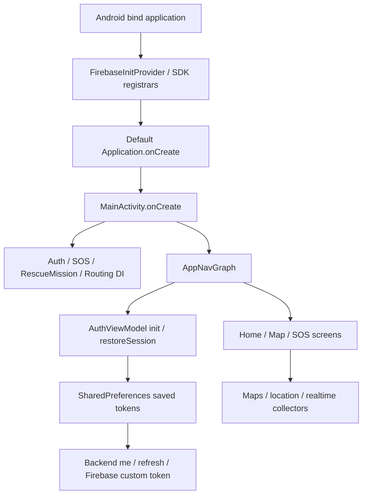

# PHASE 5 – P5-E02: Isolated Main-App Runtime Report

Ngày nghiệm thu: 2026-11-07, Asia/Bangkok. Không commit/push/deploy; dừng tại P5-E02.

## 1. Executive Summary

**CONDITIONAL — các production UI components tách được dependencies đã chạy thật và PASS; chưa cô lập toàn bộ main app.**

```text
PRODUCTION_SCREEN_SUBSET_RUNTIME = PASS
UI_INSTRUMENTATION = 15/15 PASS
FULL_APP_ISOLATION = BLOCKED
PRODUCTION_UI_E2E = NOT_RUN
FULL_APPLICATION_E2E = NOT_RUN
ROUTING_UI = NOT_IMPLEMENTED
STRICT_ROUTING_DISABLED
F06 = OPEN
```

Đã chạy nguyên source RegisterScreen, OnboardingScreen, AboutAppScreen và production loading/error/empty components trên Pixel_6_Pro API37 trong package/data riêng. Không thay bằng FixtureActivity chỉ có nút/nhãn. Có test-only shell/NavHost/adapter bao quanh actual Composables, fixture Backend và runtime permission dialog thật. MainActivity/AppNavGraph/Login/Auth repository/SOS/Maps production không được khởi tạo.

Final UI15/15; policy harness cũ debug18/18 và release-like6/6; routing JVM462/462; full JVM503/503; debug APK BUILD SUCCESSFUL. Tất cả failures/errors/skipped cuối=0, các driver/build cuối exit0. No Backend/artifact/source baseline modifications. Chỉ thêm tools/ui-harness và báo cáo.

Không gọi registration/session fixture, test-only navigation hoặc About screenshot là full application/login/SOS E2E. Giới hạn chính là dependency graph production còn gắn trực tiếp Firebase/CredentialManager/Maps, cần task riêng thay vì refactor business logic ngoài scope.

## 2. Baseline Source Preservation

Android: /home/vantri/AndroidStudioProjects/bai1. Backend READ ONLY: /home/vantri/AndroidStudioProjects/canh-bao-thien-tai-backend-app.

Đã đọc/đối chiếu P5-E01R, P5-E01, NET và CACHE reports; kiểm tra pwd/git status --short/git diff --check, ancestor/repo AGENTS.md (không instruction áp dụng), snapshot SHA-256/mtime_ns trước sửa. Baseline Android269files, Backend677files. Bao gồm untracked source từ tasks trước; không dùng git HEAD làm baseline và không reset/clean/restore user changes.

Exclude path parts .git/.gradle/build/dist/node_modules/.idea/.kotlin; generated/IDE/dependencytrees không nằm trong proof. Toàn bộ269 baseline Android source/config/tests/docs/evidence được giữ hash/mtime_ns,0modified/removed; Backend677/677unchanged,0new/modified/removed. Chỉ new standalone test project/evidence và report. .idea đang dirty từ trước, không thao tác IDE hoặc claim immutable IDE tree từ snapshot.

Snapshots /tmp/p5e02-{android,backend}-baseline.json và final/comparison counterparts. app/build.gradle.kts, root settings, MainActivity/AppNavGraph, Firebase configuration, Auth/SOS/routing business source, main/debug network policies và historical reports/evidence không sửa. Không thêm production flag, DI bypass hoặc authority shortcut.

## 3. Android Emulator Inventory

Đã tự đặt JAVA_HOME=/usr/lib/jvm/java-25-openjdk-amd64 và PATH cho process, chạy java -version và ./gradlew --offline --no-daemon --version: Java25.0.4.1, Gradle9.7.1; AGP9.4.0/Kotlin plugin2.2.10 giữ versions đã có. Không cài SDK/dependency mới; mọi Gradle command offline.

ADB devices -l, emulator inventory đã biết và getprop xác nhận:

| Trạng thái | Kết quả |
|---|---|
| AVD_EXISTS / AVD_RUNNING | true — Pixel_6_Pro |
| DEVICE_CONNECTED | true — emulator-5554, sdk_gphone16k_x86_64 |
| BOOT_COMPLETED | 1 |
| ANDROID_API_LEVEL | 37 |
| DEVICE_TESTS_EXECUTED | true |

Không wipe/reset/thay AVD. Không giả định emulator sạch hoặc đọc tài khoản/private storage. Không grant/change permission của app chính hoặc app khác. Chỉ namespace mới do task cài sau safety gate được điều khiển/dọn.

## 4. Main App Startup Dependency Audit

Audit source thực tế và merged debug manifest, không khởi chạy production APK để dò:



| Giai đoạn/component | Hành vi và đường tiếp cận dữ liệu/cloud |
|---|---|
| Trước Application.onCreate | Main manifest không custom Application, nhưng merged SDK components có FirebaseInitProvider/ComponentDiscoveryService/registrars; provider init xảy ra trước Activity |
| ContentProviders | Firebase SDK/analytics/auth/database có thể khởi tạo; AndroidX InitializationProvider và SDK receivers/services cũng có trong app chính. Không suy traffic bằng0 khi chưa chạy |
| MainActivity.onCreate | Gọi AuthAppDependencies.initialize, SosAppDependencies.initialize, RescueMissionAppDependencies.initialize, RoutingAppDependencies.initialize rồi AppNavGraph |
| AuthAppDependencies | SharedPreferencesTokenStorage dưới app data; OkHttpAuthApiClient dùng configured API; AndroidFirebaseAuthSession gọi FirebaseAuth.getInstance |
| AuthViewModel init | Tự restoreSession; không cần user bấm Login |
| AuthRepository.restoreSession | Đọc accessToken; /auth/me, có thể /auth/refresh; synchronizeFirebase gọi custom-token bridge và Firebase sign-in |
| AppNavGraph auth state | Authenticated state điều hướng Home/RoleSelection; chứa routes Map/SOS/Rescue/Settings và dependencies liên quan |
| LoginScreen | remember CredentialManager.create và Google/Firebase integration nằm trực tiếp trong Composable; không chỉ callback login/password thuần |
| RoleSelection/Forgot/Reset | Có AuthViewModel/default AuthAppDependencies hoặc DisasterRepository; không thể compile như pure screen mà không thêm seams/graph |
| SosAppDependencies | Tạo production SOS API/token provider và FirebaseSosRepository/realtime source; source mặc định FirebaseAuth.getInstance |
| Realtime collection | FirebaseSosRepository.ensureRealtimeStarted khi observeSos/observeRealtimeSos được gọi; SupervisorJob/source listeners có thể sống theo process, không tự coi Activity close là cloud stop |
| Maps/location | DisasterMapScreen dùng GoogleMap; Map/ViewModel/location providers liên quan Play Services/Fused location; không mở màn hình để dò |
| RescueMission/Routing | API clients đọc shared token, routing downloader/cache/loader được initialize; không tạo production qualification |
| Đóng main Activity | Không thấy main Activity override cleanup/logout chung; saved tokens không tự xóa chỉ vì đóng UI. Không xác nhận realtime/background SDK đã dừng bằng test subset |

Không thấy custom WorkManager enqueue/background service start trong source search, nhưng SDK manifest components/manual DI vẫn là safety blocker. Không phát hiện main Activity tự submit SOS ngay khi onCreate; điều đó không chứng minh Firebase/account/network isolation. Không truy cập real account hoặc test production startup.

Chỉ remove FirebaseInitProvider trong một overlay chưa đủ: Auth/SOS DI vẫn gọi FirebaseAuth trực tiếp và LoginScreen có credential dependencies. Cô lập toàn AppNavGraph cần DI/credential seams rộng hơn những pure screens hiện có; task này giữ production implementations nguyên trạng.

## 5. Firebase/Auth/SOS Isolation Design

Chọn standalone tools/ui-harness, applicationId mới và source whitelist. Không include vào app/root settings, không đổi release config.

Actual production source được copy nguyên bytes tại build và kiểm hash trước install:3theme files; RegisterScreen/OnboardingScreen/AboutAppScreen; CommonButtons/AppTopBar/FeedbackStates; Models.kt; AuthApiClient.kt/AuthModels.kt — tổng12files. Production routing directories compile trực tiếp; token provider interface trích exact declaration như harness E01R, không compile SOS implementation.

Không pack MainActivity, AppNavGraph, AuthRepository/AuthViewModel/AuthAppDependencies, LoginScreen, Firebase/GMS/CredentialManager, Maps/SOS client hoặc routing app DI. Runtime reflection và DEX presence/absence checks xác nhận phạm vi. Manifest bare android.app.Application, một IsolatedUiActivity không exported, allowBackup=false; AndroidX automatic startup provider/profile receiver được remove chỉ trong test variant. Không location/camera/notification permissions; chỉ INTERNET/ACCESS_LOCAL_NETWORK và own signature permission từ AndroidX core.

IsolatedUiActivity là adapter/shell test-only chứa actual Composables. NavHost của nó không là AppNavGraph production. Callback registration dùng **actual OkHttpAuthApiClient** với fixed owned local origin; synthetic token chỉ ở memory. Fixture logout/expiry gọi production routing invalidation và clear fixture memory; không được gọi đó là production AuthRepository.logout/restoreSession UI test.

Outbound client pin scheme/host/port/path trước transport và tại network interceptor; proxy/redirect/retry tự động tắt. Destination chỉ10.0.2.2 tại host127.0.0.1 owned ephemeral server. No real Backend/R2/cloud/credentials, database writes, email/SMS/push, location upload hoặc rescue mutation. Không claim packet-capture certification cho toàn emulator: assurance dựa manifest/DEX exclusion, fixed local graph và request metadata trong fixture.

## 6. Exact Files Changed

**Không chỉnh269baseline Android files hoặc bất kỳ Backend file nào.** New harness source/config files:

- `tools/ui-harness/.gitignore`
- `tools/ui-harness/README.md`
- `tools/ui-harness/build.gradle.kts`
- `tools/ui-harness/gradle.properties`
- `tools/ui-harness/host_fixture.py`
- `tools/ui-harness/run_ui_tests.py`
- `tools/ui-harness/settings.gradle.kts`
- `tools/ui-harness/src/androidTest/java/com/example/bai1/fixture/DeviceXmlListener.kt`
- `tools/ui-harness/src/androidTest/java/com/example/bai1/fixture/IsolatedInstrumentationRunner.kt`
- `tools/ui-harness/src/androidTest/java/com/example/bai1/fixture/ProductionSubsetUiTest.kt`
- `tools/ui-harness/src/main/AndroidManifest.xml`
- `tools/ui-harness/src/main/java/com/example/bai1/uiisolated/IsolatedUiActivity.kt`

Thêm docs/PHASE5_P5E02_ISOLATED_MAIN_APP_RUNTIME_REPORT.md và46evidencefiles trong tools/ui-harness/evidence. Evidence gồm15case directories (mỗi directory JUnit XML+PID-scoped logcat), aggregate XML/results/source-copy hashes/compiled policy/ảnh thật, JVM/build results, policy debug/release results và initial Espresso failure XML. Không overwrite historical P5-E01/E01R evidence.

Generated build/source copies không là production edits. Build versions/dependencies của app chính giữ nguyên. Standalone harness chỉ dùng libraries đã cache; không download.

## 7. Isolated Build Variant/Package Identity

| Thuộc tính | Giá trị |
|---|---|
| Standalone project | tools/ui-harness |
| applicationId | com.example.bai1.p5e02.uiisolated |
| instrumentation package | com.example.bai1.p5e02.uiisolated.test |
| namespace | com.example.bai1 (để actual production R/BuildConfig imports compile) |
| targetSdk / minSdk | 37 /30 |
| Activity | com.example.bai1.uiisolated.IsolatedUiActivity |
| Application | android.app.Application |
| Runner | test-only IsolatedInstrumentationRunner kế thừa AndroidJUnitRunner |

Namespace code trùng không đồng nghĩa package/data trùng: actual installed applicationId/data/UID tách riêng. Driver refuse install nếu một trong hai own namespaces đã có; không -r overwrite app/data. Trước install gate audit merged application/components/permissions/actual DEX và source-copy hashes PASS. App chính com.example.bai1 không được install/launch/grant/clear.

Standalone sử dụng cached AGP9.4.0/Compose compiler2.2.10, actual resolved activity-compose1.13.0, UI1.11.2/material3 1.4.0/navigation-compose2.10.1 và các dependency alignments đã có ở cache. Cached Espresso3.5.1 được thử nhưng không dùng trong final UI runner do API37 incompatibility; không tải bản khác để thay thế. Không thay app dependency graph.

## 8. API37 Local Network Permission

Flow chỉ trong isolated Activity: ActivityResultContracts.RequestPermission(ACCESS_LOCAL_NETWORK), actual OS PermissionController grant/deny buttons được click bằng native accessibility actions. Không pm grant để giả user consent trong grant/deny UI cases.

Driver chạy mỗi testcase trong instrumentation process riêng; trước case normal chỉ force-stop own app, revoke/clear user-set/user-fixed flags của package vừa cài để prompt có state xác định. Revocation case grant rồi revoke own package trước launch. Process-restart pair giữ OS grant từ dialog của case trước, force-stop và khởi chạy PID mới; không reset quyền trong cặp đó.

| Tình huống | Evidence |
|---|---|
| Chưa grant | System PERMISSION_DENIED; actual local probe fails; production ErrorState được dùng, không crash |
| User grant | Actual OS prompt action; callback GRANTED; host health responds đúng marker |
| User deny | Actual deny button; callback denied; UI error hợp lý, token/routing không cấp quyền |
| Revoke | pm grant/revoke đúng owned package trước test; request mới fail, recreate vẫn denied |
| Activity recreate | Grant còn hiệu lực; memory token không tự restore |
| Actual process restart | New PID, GRANTED vẫn còn; fixture session unauthenticated; local probe hoạt động |

Process restart đã xác minh PID 24422 → 24588; actual package force-stop giữa hai instrumentations.

Local permission khác NetworkSecurityPolicy. Debug exact allowlist giữ10.0.2.2/127.0.0.1/localhost; release-like cleartext deny vẫn PASS. Main app debug/release manifest không được thêm ACCESS_LOCAL_NETWORK hoặc runtime flow. Main-app permission/UI integration là task riêng; không tự cấp quyền production app.

## 9. UI Instrumentation Tests

Lệnh tái lập final (exit0):

```bash
cd /home/vantri/AndroidStudioProjects/bai1
python3 tools/ui-harness/run_ui_tests.py --evidence-dir /tmp/p5e02-ui-final15
```

Driver tự đặt Java25/SDK path và build offline:

```bash
./gradlew -p tools/ui-harness --offline --no-daemon assembleDebug assembleDebugAndroidTest
```

Build exit0. Sau gate, adb -s emulator-5554 install -t chỉ own APK/test APK; AndroidJUnitRunner chạy method filters với DeviceXmlListener và owned fixture port. Exact method/port/command trong evidence/results.json. Có thể dùng --tests cho chẩn đoán; final run không filter bỏ scenarios. Process-restart testcase yêu cầu case grant trước nó theo default order.

Counts từ actual JUnit event XML: **15tests,0failures,0errors,0skipped**, tất cả requested cases có thật trong aggregate XML; không lấy số declarations làm acceptance. Method declarations chỉ phục vụ scheduling, mỗi run phải export junitRunCount=1. Shell adb exit0 không tự là PASS.

Final tests dùng Android instrumentation/native UI Automation trên actual Compose accessibility nodes; không dùng mock Platform policy hoặc test-only fake screens thay production screens. Actions chỉ truy cập own app và Android/Google PermissionController windows. Enter form qua actual accessibility ACTION_SET_TEXT, click actual controls/dialog, verify visible text/state; không chỉnh production code để hợp API37.

| Actual runtime testcase | Kết quả |
|---|---|
| `actualProductionOnboardingAndAboutNavigationRenderWithoutCloud` | PASS |
| `realPermissionGrantEnablesLocalFixtureAndSurvivesActivityRestart` | PASS |
| `grantedPermissionSurvivesProcessRestartWithoutRestoringFixtureSession` | PASS |
| `realPermissionDenialRendersProductionErrorStateWithoutCrash` | PASS |
| `absentPermissionBlocksActualFixtureAndRestartKeepsUnauthenticated` | PASS |
| `productionRegisterUsesActualApiClientAgainstSyntheticFixtureThenLogoutClearsRouting` | PASS |
| `syntheticSessionExpiryDoesNotRestoreRoutingOnRestart` | PASS |
| `actualRegisterRenders401FixtureError` | PASS |
| `actualRegisterRenders403FixtureError` | PASS |
| `actualRegisterRenders500FixtureError` | PASS |
| `actualRegisterRendersOfflineFixtureError` | PASS |
| `actualRegisterRendersActualSocketTimeout` | PASS |
| `actualRegisterLoadingStateAndProductionFeedbackComponentsRender` | PASS |
| `revokedPermissionBlocksConnectionAndRestartsDenied` | PASS |
| `genuineProductionAboutScreenshot` | PASS |

## 10. Device Runtime Results

Production screens actual runtime: OnboardingScreen→callback/registration trong test-only graph, AboutAppScreen và back callback, RegisterScreen form/render/loading/errors. Common LoadingState/EmptyState/ErrorState/AppTopBar/buttons/theme là production code. Đây là navigation/screen subset trong fixture host, không chứng minh production AppNavGraph transitions.

| Chức năng | Status |
|---|---|
| Production component render/navigation callbacks | PASS |
| Production registration form + actual Auth HTTP client + local synthetic success | PASS |
| 401/403/500/offline/timeout loading/error/empty display | PASS |
| Runtime permission granted/denied/revoked/restart | PASS |
| Fixture session expiry/logout + production routing memory invalidation | PASS — adapter workflow only |
| Production LoginScreen / Google login / saved-account restore | BLOCKED / NOT_RUN |
| Production AuthRepository logout/session-expiry UI E2E | NOT_RUN |
| MainActivity/AppNavGraph full startup/navigation | BLOCKED / NOT_RUN |
| Firebase/Maps/SOS production UI/mutations | NOT_RUN |
| ROUTING_UI | NOT_IMPLEMENTED |

Ảnh production-about.png là capture thật từ emulator của actual AboutAppScreen bên trong isolation shell; đã xem kiểm tra, không có tài khoản/notification content/private data. Không ảnh giả, không edit screenshot để biến fixture host thành app chính. Có nhãn ISOLATED PRODUCTION UI SUBSET ngay trong ảnh.

Historical failures phân loại:

- Offline build thiếu old transitive artifacts: align standalone cached versions, không tải/cài hoặc đổi app dependencies.
- Initial Espresso UI run:14tests/14failures trước khi test body hoạt động do InputManager.getInstance NoSuchMethodException trên API37. Đây là tooling compatibility, không ghi là production screen defect. Giữ initial JUnit XML; chuyển các assertions/scenarios sang native UI Automation, không ignore test hoặc patch platform/production để làm xanh.
- Permission selector ban đầu chỉ nhận AOSP controller; sửa test helper nhận đúng Android/Google PermissionController package/resource suffix.
- Local fixture thiếu Connection:close khiến client reuse socket đã đóng; sửa HTTP server semantics, không nới retry/network policy production.
- Loading timer ngắn khó quan sát: thay fixture bằng controlled response barrier; test thấy actual production progress indicator rồi release response qua owned local control endpoint.

Sau sửa harness/fixture, toàn bộ15final cases PASS. Không có production business defect được remediation trong task; chưa đủ coverage để khẳng định main app không có lỗi.

## 11. Backend Fixture Behavior

Đã đọc Backend READ ONLY: Auth controller/DTO có /auth/register/login/refresh/me, success/data envelope; register fullName/email-or-phone/password. Routing controller dùng JWT/roles guards, storage TTL900s, raw application/gzip. Không chạy real Backend/database hoặc mô phỏng certificate approval.

Owned Python ThreadingHTTPServer bind127.0.0.1 ephemeral port, không forwarding. Adapter chỉ cho http://10.0.2.2:<owned-port> và whitelisted paths. Synthetic email/password chỉ fixture; không production JWT, token không có giá trị auth ngoài fixture. Request bodies bị giới hạn4KiB và không log/persist. Metadata chỉ method/path/mode/bearer-present boolean.

| Fixture | Hành vi |
|---|---|
| /auth/register (actual client/UI) | Synthetic success/data tokens; mode401/403/500; body phải synthetic fields |
| /auth/login | Contract fixture có sẵn, không được mô tả là LoginScreen E2E đã chạy |
| offline mode | Owned transport IOException trước outbound; không đổi production error mapping |
| timeout mode | Actual socket read timeout, production Auth client map TIMEOUT |
| slow mode | Response barrier cho UI loading, released bởi owned /fixture/release-loading |
| /health | Static P5E02_LOCAL_ONLY marker cho local permission tests |
| /routing/current | Synthetic download-only, false readiness; requires only fixture token |
| /graph.gz | Valid deterministic synthetic raw GZIP/SHA/schema; reject Bearer/cookie |

Registration UI success case gọi production routing API/download/parser thật; synthetic graph2nodes/1UNVERIFIEDedge, strictRoutingReady/canNavigateSafely false. Logout fixture xóa token và current routing status, không authority từ digest. Không tạo routing UI hoặc gọi đó là UI route/navigation E2E.

Final fixture recorded 13owned requests. Routing current events: 1; graph events: 1. Graph events đều không Bearer; không SOS/location/cloud endpoint.

## 12. Logcat/Crash Findings

Logcat --pid=<own PID> -v threadtime -T <device timestamp trước mỗi test>; không clear hoặc lấy global/app khác logs. Actual runner chờ1.5s trước test để attach. Native UI root chỉ đọc own package/PermissionController, không inspect tài khoản/app khác.

Final15case logs đã scan: không FATAL EXCEPTION/ANR marker, không fixture token/password/raw presigned signature trong test window. Không claim system-wide ANR detector, packet capture hoặc leak certification cho emulator/apps khác. HTTP/network error diagnostics fixed production mapping, adapter diagnostic redacts owned URL; final errors được assert qua actual UI.

Evidence gồm individual XML+PID log và aggregate XML/results. Screenshot chỉ pull bằng run-as own newly installed package trước cleanup. Server không log credentials/body. Archived artifacts được scan trước report; original tooling failures không bị gọi PASS hoặc xóa để che kết quả.

## 13. Routing Security Regression

Fresh routing command:

```bash
./gradlew --offline --no-daemon :app:testDebugUnitTest --rerun-tasks \
  --tests 'com.example.bai1.rescue.routing.*'
```

Exit0, **462tests/13suites,0failures/errors/skipped** từ JUnit XML. Giữ F01–F05/F07/F08 strict/context/session, GZIP binding, cache transaction/path containment và error fail-closed. Source/cache/router không đổi.

Đã chạy lại old isolated network harness theo sequence không trùng UI foreground:

```bash
python3 tools/emulator-harness/run_device_tests.py --variant releaseLike --evidence-dir /tmp/p5e02-policy-release
python3 tools/emulator-harness/run_device_tests.py --variant debug --evidence-dir /tmp/p5e02-policy-debug
```

Cả hai exit0: release-like6/6,debug18/18;0fail/errors/skipped. API37 localhost deny/actual IPv4+IPv6 socket tests và exact debug allowlist vẫn PASS. Không sửa actual main/debug XML đã nghiệm thu P5-E01R. Không lấy debug result thay release proof.

## 14. Full JVM Regression

```bash
./gradlew --offline --no-daemon :app:testDebugUnitTest
```

Exit0, BUILD SUCCESSFUL: **503tests/26suites,0failures,0errors,0skipped**. Counts đọc từ actual XML sau full run; không giả định503 theo baseline hoặc cộng overlapping suites. Full includes Auth/SOS regression nhưng không chứng minh UI/cloud E2E.

Logs /tmp/p5e02-routing.log và /tmp/p5e02-full.log; XML snapshots /tmp/p5e02-routing-results, /tmp/p5e02-full-results. Actual reports tại app/build/test-results/testDebugUnitTest và app/build/reports/tests/testDebugUnitTest/index.html. Archived summary evidence/jvm-build-results.json. Existing StateFlow inheritance/deprecation warnings giữ nguyên; không sửa business source hoặc nâng dependencies để che warnings.

## 15. APK Build Results

Production app build only:

```bash
./gradlew --offline --no-daemon :app:assembleDebug
```

Exit0, BUILD SUCCESSFUL. Không install/launch app chính. Artifact:

`/home/vantri/AndroidStudioProjects/bai1/app/build/outputs/apk/debug/app-debug.apk` — 96,434,434bytes, SHA-256 `b906a76df36f4b09fcfc7861ffe885dc68694131df22b9e9e8faace616e524dd`.

Standalone UI APK build exit0, preinstall gatePASS; target SHA-256 `3c3163c296045278300dfcdb27e775f5671e726bfa9a9970f45dd226373bced3`.

Target/test APKs chỉ own namespaces, install -t không -r; final uninstall chỉ packages proven absent trước task install. owned_packages_remaining=[] trong final results. Không ký/phát hành production release APK, không deployment. Source build variants app/release config không đổi.

## 16. Remaining Unisolated Components

**FULL_APP_ISOLATION=BLOCKED; PRODUCTION_UI_E2E=NOT_RUN.** MainActivity/AppNavGraph và LoginScreen vẫn cần tách dependency/credential seams để test full graph an toàn. AuthViewModel/AuthRepository restore/account lifecycle, role selection, forgot/reset flows, Settings/Home with DisasterRepository, Maps/location, SOS/realtime/notifications, rescue screens chưa được chạy UI trong task này.

Chưa có safe main-app variant khởi tạo toàn DI với fixture repositories; không dùng token/account production hoặc remove provider rồi giả rằng mọi manual SDK init biến mất. Chưa chứng minh production app khi đóng ngừng mọi collectors/cloud SDK. Task không sửa các implementations đó.

API37 permission flow chỉ proven trong isolated subset Activity. Process restart covered với own package/PID; không là saved-production-account restore hoặc kill/recovery safety cho real SOS/field state. UIAutomation final15cases không bằng full device/API matrix; chỉ một API37 emulator, không physical device/performance/real TLS/R2 certification. Native tool fallback vì cached Espresso incompatibility là limitation của preferred Compose test automation, không tự download workaround.

## 17. F06 / Parity / P5-I02 Gaps

F06 OPEN; chưa có production-authoritative qualification/live hazard freshness. READY/VERIFIED_COMPATIBLE/count/digest/ATTACHED hoặc fixture không cấp strict routing. **No production-authoritative qualification => STRICT_ROUTING_DISABLED.**

ROUTING_UI=NOT_IMPLEMENTED; không tạo route UI. Kotlin–TypeScript parity/P5-P01 và real Android–Backend full E2E/P5-I02 không thực hiện. Không mô tả synthetic graph/network fixture là field-verified hoặc đường cứu hộ an toàn. Backend/graph artifacts không đổi.

CACHE power-loss/sameUID-race/retained-generation-quota và NET cross-device/real network limitations còn như báo cáo trước; không nâng assurance của chúng bằng subsetUI PASS.

## 18. Final Acceptance

**CONDITIONAL — P5-E02.** Isolated production screen subset + real permission flow + device automation đã triển khai và PASS; full main-app isolation còn BLOCKED, nên không PASS full application/E2E.

| Acceptance | Status |
|---|---|
| Separate package/data; no production provider/Auth/SOS init | PASS trong packaged subset |
| Actual production UI components run on emulator | PASS |
| Final UI instrumentation | PASS —15/15 |
| Permission grant/deny/revoke/Activity + process restart | PASS — OS dialog và newPID evidence |
| Existing debug/release security harness | PASS —18/18 và6/6 |
| Routing/full JVM + debug APK | PASS —462/503 và build exit0 |
| Backend/artifact/baseline source preservation | PASS |
| Full MainActivity/AppNavGraph isolation | BLOCKED |
| Production Login/Google/SOS/Maps/full UI E2E | NOT_RUN |
| Routing UI | NOT_IMPLEMENTED |
| Strict rescue routing | DISABLED |

Không production cloud/SOS outbound path trong selected graph, không dùng real accounts; không grant/appdata mutation của package khác. Không commit/push/deploy hoặc tiếp tục ngoài P5-E02.

## 19. Recommended Next Task

Task riêng cho minimal DI/credential seams: tách Google credential/Firebase launcher khỏi LoginScreen, hỗ trợ fixture Auth/SOS/rescue dependencies khi chạy isolated main graph và chứng minh provider/manual SDK init đều bị loại. Giữ default production behavior và release unchanged, có compatibility/JVM/device regression rõ ràng. Không tự làm refactor đó trong task hiện tại.

Sau khi full graph isolation được nghiệm thu mới test production Login/restore/logout và navigation rộng hơn. Real Backend E2E/P5-I02, parity/P5-P01, F06 và routing UI cần scopes riêng. Chỉ đề xuất; dừng đúng P5-E02, không mở strict routing hoặc deploy.
