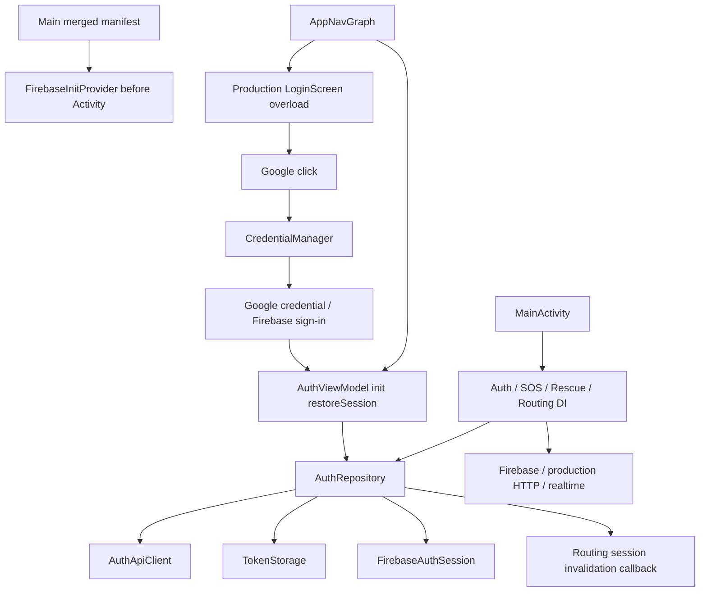

# P5-E04-USB — Production Auth Isolation and Real Phone UI

Ngày thực thi: 2026-11-08, Asia/Bangkok. **PASS cho AUTH/UI SCOPE được định nghĩa dưới đây; FULL_APPLICATION_E2E=NOT_RUN.**

## 1. Executive Summary

Đã chạy **actual production LoginScreen**, RegisterScreen, AuthRepository, AuthViewModel và SharedPreferencesTokenStorage trên **OPPO CPH2159 / Android13 / API33 / USB**, với HTTP/storage/Firebase/credential dependencies cô lập. Không dùng emulator hoặc tài khoản thật.

Final physical instrumentation: **44 unique cases / failures=0 / errors=0 / skipped=0**, driver exit0 và từng ADB instrumentation exit0. Gồm **16 old physical regression + 28 new Auth cases**. Fresh routing JVM **462/462**, full JVM **513/513**, debug APK build SUCCESSFUL. Không cộng focused/development runs vào 44 unique cases.

```text
PRODUCTION_LOGIN_UI = PASS
PRODUCTION_REGISTER_VALIDATION = PASS (tested matrix)
AUTH_REPOSITORY_FIXTURE_LIFECYCLE = PASS
AUTH_VIEWMODEL_FIXTURE_UI = PASS
OLD_16_PHYSICAL_REGRESSION = PASS
AUTH_UI_SCOPE = PASS
FULL_APP_ISOLATION = BLOCKED
PRODUCTION_APP_NAV_GRAPH = NOT_RUN
FULL_APPLICATION_E2E = NOT_RUN
REAL_GOOGLE_FIREBASE_AUTH_E2E = NOT_RUN
ROUTING_UI = NOT_IMPLEMENTED
F06 = OPEN
STRICT_ROUTING_DISABLED
```

[Physical results](../tools/ui-harness/evidence/p5e04-usb/physical-final/results.json), [runtime JUnit44](../tools/ui-harness/evidence/p5e04-usb/physical-final/TEST-production-ui.xml), [coverage groups](../tools/ui-harness/evidence/p5e04-usb/coverage-groups.json), [exit codes](../tools/ui-harness/evidence/p5e04-usb/driver-exit-codes.json). Full-app/cloud behavior không được nghiệm thu bởi fixture PASS.

## 2. Laptop/Phone Disk Space Gate

Trước build, `df -h / /home`: root **7.8G available**, /home **11G available**. Phone `/data`: **108G total /100G used /8.3G free**. Gates **PASS**. Driver/JVM validation script kiểm lại available bytes trước build, dừng nếu root <2 GB. Không dọn Docker/Snap/Gradle/SDK/AVD hoặc dữ liệu cá nhân. [Final disk receipt](../tools/ui-harness/evidence/p5e04-usb/disk-after.txt), [phone metadata](../tools/ui-harness/evidence/p5e04-usb/device-and-cleanup.json).

## 3. Physical USB Device Inventory

`adb devices -l`: đúng một physical USB device, model **CPH2159**, state `device`; không emulator/offline/unauthorized hoặc thiết bị thứ hai. Đọc actual release13/API33/boot_completed1; driver kiểm ro.kernel.qemu không là1. Serial chọn từ inventory, mọi device command target serial đó; report/evidence lưu **REDACTED**, không hardcode serial trong runner. Không bypass authorization hoặc thao tác system permission dialog.

API37 ACCESS_LOCAL_NETWORK assertions **NOT_APPLICABLE** trên phone API33. Physical mode tiếp tục từ chối API37+ trước install nếu chưa có user-led permission workflow. Không lấy API33 hoặc emulator lịch sử chứng minh policy API37.

## 4. Repository Source Baseline

Đã đọc P5-E03, P5-E02, P5-E01R, P5-A01R-NET reports và actual Auth/UI/harness source. `pwd`, `git status --short`, `git diff --check` thực hiện trước sửa; có existing dirty/untracked files từ các task trước. Không tìm thấy AGENTS.md áp dụng ở ancestors/repo.

Snapshot SHA-256 + mtime_ns: **451 Android baseline files**, **677 Backend files**. Loại `.git/.gradle/build/dist/node_modules/.idea/.kotlin` generated/environment directories; không dùng git diff để thay thế hash check cho untracked files. Không reset/clean/restore hoặc commit/push/deploy. [Android baseline](../tools/ui-harness/evidence/p5e04-usb/android-baseline.json), [Backend baseline](../tools/ui-harness/evidence/p5e04-usb/backend-baseline.json).

## 5. Production Auth Dependency Audit



Register validation thuộc actual RegisterScreen; login blank checks thuộc AuthRepository. HTTP login/register/refresh/me/custom-token thuộc AuthApiClient. TokenStorage giữ saved session; ViewModel init khôi phục; repository sync Firebase adapter, logout clear storage/signOut/invalidate routing. AppNavGraph chọn authenticated destinations nhưng còn kéo SOS/Maps/production DI.

Trước sửa LoginScreen `remember` khởi tạo CredentialManager khi render. Sau sửa production overload chỉ tạo CredentialManager khi Google click. Main manifest FirebaseInitProvider và MainActivity Auth DI vẫn có thể init Firebase trước click: **chưa cô lập full main app**, không cài/mở com.example.bai1.

## 6. LoginScreen Injection Design

Giữ actual UI source trong `LoginScreen.kt`, thêm required `onGoogleSignInClick` callback; không Firebase/GMS/CredentialManager import/reference trong file UI. Existing seven-argument/default call sites như AppNavGraph resolve tới overload ở `ProductionLoginScreen.kt`, gọi cùng actual UI và giữ nonce/account-picker/Firebase token bridge flow. CredentialManager creation chuyển từ eager remember sang sau click.

Standalone chỉ copy file UI; phải inject callback rõ ràng. Fixture callback báo synthetic cancellation, không mở account picker hoặc dùng Google/Firebase SDK. Thêm accessibility description cho Google button để bấm chính nút UI. Không có isTest flag hoặc synthetic credential trong production default.

AuthRepository routing invalidator trở thành required injected parameter; AuthAppDependencies cung cấp **cùng production invalidation callback trước đây**, không đổi authorization. FirebaseAuthSession interface tách khỏi AndroidFirebaseAuthSession implementation; thân implementation production giữ nguyên byte-for-byte. Existing AuthRepository unit tests chỉ thêm explicit callback, không giảm assertion. AuthViewModel và TokenStorage production logic giữ nguyên.

## 7. Register Validation Root Cause

Actual pre-fix UI submit gọi callback trực tiếp, bỏ qua confirmPassword/agreeTerms và không chặn form invalid. Đã viết negative runtime tests **trước sửa** rồi chạy actual original RegisterScreen trên phone: **5 tests /5 failures /0 errors /0 skipped, driver exit1**, cả5 tạo HTTP register request. Cases: confirmation mismatch, unchecked terms, blank fields, invalid email, invalid phone. [Before-fix XML/results](../tools/ui-harness/evidence/p5e04-usb/before-validation-fix/results.json).

Contract READ ONLY: Backend RegisterDto fullName string max100; email validator; phone string length8..15; password min6; auth service yêu cầu email hoặc phone. UI có confirmation và checkbox “Tôi đồng ý…” nên các controls phải được kiểm tra trước submit. Backend conditional validators có thể bỏ checks khi cả hai contacts được cung cấp; UI chủ động kiểm mỗi supplied contact. Phone vẫn là string length8..15, không thêm country/digit policy. Email client check chặn common malformed/whitespace forms, không được coi là full RFC/server-validation replacement.

Sửa production `registrationValidationError` và gọi từ **actual RegisterScreen** trước callback: nonblank name, max100, ít nhất một contact, supplied email/phone format/length, password>=6, exact untrimmed password confirmation, existing checkbox checked. Contact/name trim trước callback; không trim password. Existing terms text và default checked=true giữ nguyên; không thêm legal content, server consent policy hoặc consent-record claim. Valid email-only/phone-only/both flows vẫn được kiểm thử.

## 8. Exact Source Changes

12 baseline files sửa đúng scope:

- `tools/ui-harness/README.md`
- `tools/ui-harness/build.gradle.kts`
- `tools/ui-harness/run_ui_tests.py`
- `tools/ui-harness/host_fixture.py`
- `tools/ui-harness/src/main/java/com/example/bai1/uiisolated/IsolatedUiActivity.kt`
- `tools/ui-harness/src/androidTest/java/com/example/bai1/fixture/ProductionSubsetUiTest.kt`
- `app/src/main/java/com/example/bai1/auth/AuthRepository.kt`
- `app/src/main/java/com/example/bai1/auth/AuthAppDependencies.kt`
- `app/src/main/java/com/example/bai1/auth/firebase/FirebaseAuthSession.kt`
- `app/src/main/java/com/example/bai1/presentation/auth/RegisterScreen.kt`
- `app/src/main/java/com/example/bai1/presentation/auth/LoginScreen.kt`
- `app/src/test/java/com/example/bai1/auth/AuthRepositoryTest.kt`

New source/test files:

- `app/src/main/java/com/example/bai1/presentation/auth/ProductionLoginScreen.kt`
- `app/src/main/java/com/example/bai1/presentation/auth/RegistrationValidation.kt`
- `app/src/main/java/com/example/bai1/auth/firebase/AndroidFirebaseAuthSession.kt`
- `app/src/test/java/com/example/bai1/presentation/auth/RegistrationValidationTest.kt`

Mới: báo cáo này và `tools/ui-harness/evidence/p5e04-usb/`. [Exact changed/new file manifest](../tools/ui-harness/evidence/p5e04-usb/changed-files.json), [before/after SHA and mtime](../tools/ui-harness/evidence/p5e04-usb/android-preservation.json), [evidence hash index](../tools/ui-harness/evidence/p5e04-usb/evidence-index.json). Không sửa app build/dependency versions, MainActivity/AppNavGraph, AuthViewModel, TokenStorage, AuthApiClient, network policy, Firebase configuration, SOS/Maps, routing authority hoặc Backend trong task này; các dirty changes có trước được bảo toàn.

## 9. Firebase/SOS Isolation Proof

Pre-install manifest gate: bare android.app.Application, một non-exported IsolatedUiActivity, allowBackup=false, no provider/service/receiver/meta-data tự startup; permissions chỉ INTERNET/future local-network/own signature permission. APK DEX gate loại Firebase/GMS/CredentialManager, production Google overload, AndroidFirebaseAuthSession, app DI/MainActivity/AppNavGraph/SOS client; xác nhận actual Login/Register/AuthRepository/AuthViewModel/SharedPreferencesTokenStorage classes có mặt.

**18 exact production Kotlin copies**, byte equality và SHA so với original source trước install; không transform repository logic hay dùng fake repository. [Source-copy hashes](../tools/ui-harness/evidence/p5e04-usb/physical-final/source-copy-hashes.json). Firebase dependency được inject bằng no-cloud interface implementation chỉ ghi invocation counts; credential callback cancellation không tạo SDK account access.

Main debug APK vẫn chứa production Login overload và AndroidFirebaseAuthSession; scan main DEX không thấy fixture password/access/expired-token literals. [Production boundary proof](../tools/ui-harness/evidence/p5e04-usb/production-boundary.json). Không diễn giải gate standalone thành main-app isolation PASS.

## 10. USB Backend Fixture

Owned Python server bind **laptop 127.0.0.1:34617**, OS cấp unused ephemeral port. Kiểm existing reverse mappings trước tạo `tcp:34617` → `tcp:34617`. Phone chỉ dùng **127.0.0.1**, không 10.0.2.2/LAN/Wi-Fi/production fallback. Client pin scheme/host/port/path ở interceptors; proxy/redirect/auto retry tắt. Bounded request bodies<=4096 bytes; không log bodies/token values hoặc forward Internet.

Synthetic endpoints: register/login/me/refresh/firebase-token, health marker, routing/current, graph.gz và loading barrier. `/auth/firebase-token` là response envelope ở **local owned fixture**, không gọi Firebase; NoCloudSession không dùng FirebaseAuth. Synthetic strings không phải JWT/production qualification. Method/path/mode/bearer-present booleans là request evidence.

Old missing-reverse và new Login missing-reverse đều remove đúng owned mapping, fail closed và restore cho ca sau. Final reverse list rỗng; server shutdown; không dùng --remove-all hoặc rút cáp.

## 11. Login UI Instrumentation

Actual production LoginScreen render/logo/fields/native form submit **PASS**. Callback login đi qua actual AuthViewModel → AuthRepository → pinned actual OkHttpAuthApiClient → USB fixture → actual storage/me/session adapter. Login success/logout, blank input no HTTP, HTTP401 invalid credentials,403,500, timeout, offline, missing reverse, actual loading text và cancellation **PASS**. Google button thật gọi injected cancellation callback, no cloud initialization.

Không thay LoginScreen bằng fake screen; authenticated EmptyState/test navigation shell được ghi rõ là adapter, không production Home/AppNavGraph. Production cloud credential success và actual account picker **NOT_RUN**.

## 12. Register Negative Validation Tests

Final physical validation matrix **8/8 PASS**, callback counter=0 và host events=[] cho từng ca. Không tạo HTTP request khi form invalid:

| Method | Result | HTTP requests |
|---|---|---:|
| authRegisterMismatchBlocksHttp | PASS | 0 |
| authRegisterUncheckedTermsBlocksHttp | PASS | 0 |
| authRegisterBlankFieldsBlockHttp | PASS | 0 |
| authRegisterInvalidEmailBlocksHttp | PASS | 0 |
| authRegisterInvalidPhoneBlocksHttp | PASS | 0 |
| authRegisterMissingContactBlocksHttp | PASS | 0 |
| authRegisterBlankPasswordBlocksHttp | PASS | 0 |
| authRegisterTooLongNameBlocksHttp | PASS | 0 |

Positive existing both-contact registration cùng new email-only/phone-only registration **PASS**. Ten new production-validator JVM tests PASS, gồm boundary lengths, required contact/name, supplied contact checks, minimum password, exact confirmation và checkbox. Focused after-fix run **6/6 PASS**, không cộng vào final44.

Commands:

```sh
python3 tools/ui-harness/run_ui_tests.py --physical-usb --tests authRegisterMismatchBlocksHttp,authRegisterUncheckedTermsBlocksHttp,authRegisterBlankFieldsBlockHttp,authRegisterInvalidEmailBlocksHttp,authRegisterInvalidPhoneBlocksHttp --evidence-dir /tmp/p5e04-before-fix
python3 tools/ui-harness/run_ui_tests.py --physical-usb --evidence-dir /tmp/p5e04-full-physical
```

Before-fix exit1 là defect reproduction được giữ, final exit0 là kết quả sau sửa, không đổi expected assertions để làm xanh.

## 13. AuthRepository/Session Tests

**PASS trong injected fixture scope**: production repository login/register/me/store/Firebase adapter synchronization, errors/loading, logout, expiry/refresh rejection và refresh success. Logout clear actual owned SharedPreferences, gọi no-cloud signOut và invalidate production routing memory. Expired synthetic access token dẫn actual me401 rồi refresh; rejection clear storage/Unauthenticated, success restore user nhưng không authorize strict routing.

Activity recreation tạo actual AuthViewModel mới, actual repository restore từ owned storage. Ordered process pair giữ synthetic storage, driver force-stop own package, xác minh **PID khác**, restore qua actual HTTP me, rồi logout clear storage. Không giả lập process restart bằng Activity recreation.

Harness dùng test-owned Activity-scoped ViewModelStore và clear khi Activity destroy; production AuthViewModel scope cancellation được thực thi. Slow login bị close/cancel không expose Authenticated hoặc phục hồi saved session sau mở mới. Đây không phải proof cho mọi concurrent login/logout/refresh race. Firebase cleanup của real SDK khi refresh failure, account switching, production token lifetime và production AppNavGraph retention **NOT_RUN / chưa chứng nhận**; không thay bằng counter để tuyên bố cloud E2E.

## 14. Navigation Results

Actual screens trong test-only NavHost: onboarding skip → Login; Login → Register; Register → Login; About/back; login success → fixture authenticated presentation; logout → Login; expired/rejected refresh → login required; recreate/process restart **PASS**.

**PRODUCTION_APP_NAV_GRAPH=NOT_RUN**. AppNavGraph còn production DI/SOS/Maps dependencies; không compile/run nó trong isolated target. Không gọi test NavHost là production navigation E2E. MainActivity, Home/role selection, forgot/reset, Maps/SOS/rescue screens **NOT_RUN**.

## 15. Old 16 Physical Regression Cases

Đã chạy lại **đủ đúng16 names** từ actual P5-E03 results, tất cả PASS, failures/errors/skipped=0. Bao gồm Onboarding/About, Register success/error/loading/expiry, socket timeout/offline/reset, USB marker/missing reverse, login API, actual debug policy, GZIP/parse/SHA/cache/tamper/recovery/invalid graph và strict denial.

[Extracted runtime old16 XML](../tools/ui-harness/evidence/p5e04-usb/TEST-old16.xml), [new28 XML](../tools/ui-harness/evidence/p5e04-usb/TEST-new-auth.xml). Đây là subsets trích từ final44 execution XML, không phải thêm lượt chạy để cộng counts. Old cloud-absence assertion cập nhật có chủ đích: AuthRepository nay phải có trong APK, còn AndroidFirebaseAuthSession/production Google overload/SDK/DI phải vắng; không bỏ strict/network/cache behavior assertions.

Final full command exit0; 44 tests chính xác bằng **16 old +28 new**, không cộng before-fix5/focused6 hoặc overlapping XML thêm lần nữa. API37-only permission cases NOT_APPLICABLE, screenshot NOT_RUN; không dùng historical emulator results.

## 16. Routing Security Tests

Fresh command:

```sh
./gradlew --offline --no-daemon :app:testDebugUnitTest --rerun-tasks --tests 'com.example.bai1.rescue.routing.*'
```

**462 tests /13 suites /0 failures /0 errors /0 skipped /exit0**. Actual XML lưu riêng. Phone graph/cache old scenarios PASS; backend readiness false/auth success/synthetic session không cấp strict permission; logout/expiry invalidate routing memory. Routing authorization/UCS/Qualification Engine/policies giữ baseline hashes/mtimes. Invariant **NO PRODUCTION-AUTHORITATIVE QUALIFICATION => STRICT_ROUTING_DISABLED**.

## 17. Full Android JVM Results

```sh
./gradlew --offline --no-daemon :app:testDebugUnitTest
```

**513 tests /27 suites**, failures=errors=skipped=0, exit0. Baseline503 +10 new validation tests; routing462 là overlapping subset, không cộng thành tổng khác. Counts đọc actual XML sau mỗi invocation, không nhận UP-TO-DATE làm fresh test evidence. [Commands/counts](../tools/ui-harness/evidence/p5e04-usb/jvm-build/results.json), XML/logs trong `jvm-build/`.

Toolchain giữ Java/javac25.0.4.1, Gradle9.7.1, AGP9.4.0, cached Kotlin/SDK; offline/no-daemon, không nâng/cài dependencies. Compiler warnings có trước trong routing/SOS tests không được sửa ngoài scope.

## 18. APK Build Results

```sh
./gradlew --offline --no-daemon :app:assembleDebug
```

**BUILD SUCCESSFUL /exit0**, main APK `95,389,966` bytes, SHA-256 `fe1b6de40836b692b25c1d76ec8f5d3f401b75636910575a36e1d59b1af04d79`. Không install/launch main com.example.bai1.

Standalone `assembleDebug assembleDebugAndroidTest` build exit0, audit xong trước install. Target SHA-256 `cf6018e1de4f053abf80c796e575d3d0e9b6b9663208f711ee82bf6925061a1a`. Exact12→18 copy-set expansion có audit; APK/package riêng com.example.bai1.p5e02.uiisolated và .test đều absent trước install. Không install -r hoặc đè package có sẵn. Debug policy copied từ actual unchanged production main/debug files.

## 19. Logcat/Crash/Privacy Results

Chỉ owned PID + per-case start window; không clear/read global logs. Review final/development collected artifacts: **0 FATAL EXCEPTION/ANR markers,0 unexpected Firebase/CredentialManager initialization markers,0 fixture secret literal leaks**. [Log review](../tools/ui-harness/evidence/p5e04-usb/log-review.json). Expected HTTP errors/timeout/offline là test scenarios, không bị coi như app crash. No redirect/proxy fallback trong client.

Timing: **46 Activity launches**, min589ms / median1633.5ms / max1930ms từ ActivityScenario.launch tới visible shell; gồm warm/repeated Activity launches, không phải cold-start benchmark. Tiny USB graph download+parse **52ms**. Per-case instrumentation duration lưu riêng và có overhead input/driver, không được gọi API latency. Loading/cancel/error UI behavior được assertion, không suy rộng hiệu năng mọi điện thoại. Memory/large graph benchmark NOT_RUN.

Screenshot **NOT_RUN** để tránh notifications/status bar cá nhân. Không tuyên bố toàn bộ ứng dụng/điện thoại không crash chỉ từ test window này.

## 20. Personal Phone Preservation

Không root/unlock/flash/wipe/reset, không pm clear/global settings/Play Protect changes, không đọc IMEI/account/contact/photos/private data app khác, không cấp camera/location/microphone/SMS, không gửi SOS/location hoặc dùng account thật.

Chỉ install hai distinct packages absent trước mỗi driver run, mỗi lượt chỉ stop/uninstall task-created packages. Actual SharedPreferences và cache writes giới hạn trong owned namespace; reset test storage qua chính TokenStorage của package đó. Final both package paths rỗng, owned_packages_remaining=[], cleanup_errors=[], reverse list rỗng, ADB vẫn state device/boot1. [Cleanup receipt](../tools/ui-harness/evidence/p5e04-usb/device-and-cleanup.json). Không đọc toàn bộ dữ liệu phone để tạo forensic preservation claim.

## 21. Backend/Graph Artifact Preservation

**677/677 Backend files unchanged SHA-256+mtime_ns**, không missing; bao gồm **20 output graph/manifest JSON/GZIP artifacts**. Backend READ ONLY, không chạy production API/database hoặc sửa qualification/artifacts.

Android **439/451 baseline files unchanged**, đúng12 edited files ở phần8, không baseline file mất; new source/report/evidence tách riêng. Existing main/debug manifest/network settings, MainActivity/AppNavGraph/AuthViewModel/storage/client/SOS/Maps/configuration và historical evidence giữ baseline. [Android preservation](../tools/ui-harness/evidence/p5e04-usb/android-preservation.json), [Backend preservation](../tools/ui-harness/evidence/p5e04-usb/backend-preservation.json). Generated Gradle/APK directories excluded rõ ràng; không dùng whole-git dirty diff để nhận thay đổi của task trước là task này.

## 22. Remaining Full App Isolation Blockers

Main merged Firebase provider; eager AuthAppDependencies Firebase implementation; SOS realtime/production API; Maps/location; shared DI and full AppNavGraph. Production Google button flow vẫn dùng CredentialManager/Firebase mặc định nhưng chưa chạy account picker/cloud. Real Firebase expiry cleanup và arbitrary concurrent auth operations cần task riêng; hiện chỉ chứng nhận injected dependency scope đã thực thi.

Production Auth/UI scope đã chạy actual source; full MainActivity/AppNavGraph/Maps/SOS E2E vẫn BLOCKED/NOT_RUN. Không mở full app trên personal phone khi chưa gate PASS.

## 23. Remaining F06/Parity/P5-I02 Work

F06 **OPEN**; không sửa hazard semantics/parity/P5-P01/P5-I02/Qualification Engine/UCS authorization. Routing UI NOT_IMPLEMENTED. Hash/verified edges/fixture login/device PASS không production-authoritative qualification và không chứng nhận tuyến cứu hộ an toàn. Strict routing **DISABLED**.

## 24. Final Acceptance

**PASS — P5-E04-USB (AUTH/UI SCOPE)**: actual LoginScreen và RegisterScreen trên phone, validation before/after proof, actual injected production AuthRepository/ViewModel/storage lifecycle, all old16 +new28 physical cases PASS, routing/full JVM PASS, debug APK build PASS, no production cloud/SOS, cleanup và Backend/artifact preservation verified.

Scope này chủ động không bao gồm production AppNavGraph/Maps/SOS như acceptance cho phép. **FULL_APP_ISOLATION=BLOCKED; FULL_APPLICATION_E2E=NOT_RUN**. Real cloud auth/Firebase lifecycle hoặc full graph không được nâng thành PASS. Initial defect reproduction5/5 failures được giữ; không còn failing final acceptance case. Không commit/push/deploy.

## 25. Recommended Next Task

Đề xuất task nhỏ riêng về Auth lifecycle concurrency/expiry cleanup (đặc biệt real Firebase session cleanup semantics), sau đó main-app dependency/startup isolation cho AppNavGraph/SDK graph trước khi mở rộng phone E2E. Giữ user-controlled account/permission dialogs và strict routing lock. Không tự làm task tiếp theo, F06/parity/P5-I02 hoặc Routing UI.
