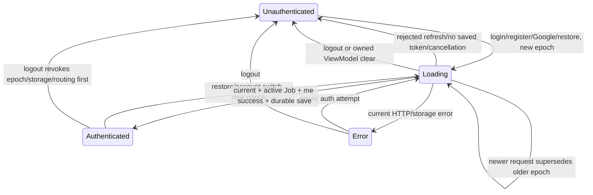
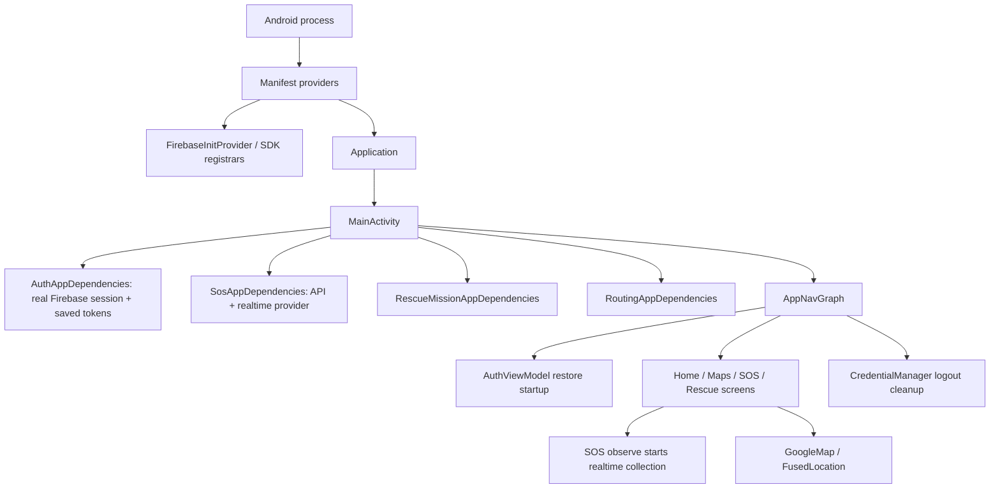

# P5-E05-USB — Auth Lifecycle and Main Navigation Isolation

Ngày thực thi 2026-11-08, Asia/Bangkok. **CONDITIONAL overall: PASS Auth lifecycle scope; MAIN_GRAPH_ISOLATION=BLOCKED.**

## 1. Executive Summary

Đã tái hiện lỗi concurrency/cleanup trên actual AuthRepository/AuthViewModel trước sửa: **18 JVM tests,16 failures,0 errors,0 skipped**, exit1. Sau remediation và regression mới: fresh routing **462/462**, full Android JVM **536/536**, APK debug BUILD SUCCESSFUL.

Final OPPO USB instrumentation: **76 unique tests,0 failures,0 errors,0 skipped**, driver exit0; từng instrumentation invocation exit0. Gồm **44 old physical +12 new HTTP/UI lifecycle +20 shared deterministic repository tests chạy trong Android process**. Không dùng JVM hoặc emulator thay physical evidence. Focused/intermediate repetitions không cộng vào76.

```text
AUTH_LIFECYCLE_SCOPE = PASS
PRODUCTION_SCREEN_SUBSET = PASS
MAIN_GRAPH_ISOLATION = BLOCKED
PRODUCTION_APP_NAV_GRAPH = NOT_RUN
MAIN_NAVIGATION_SUBSCOPE = BLOCKED
FULL_APPLICATION_E2E = NOT_RUN
REAL_FIREBASE_SDK_CLEANUP = NOT_RUN
ROUTING_UI = NOT_IMPLEMENTED
F06 = OPEN
STRICT_ROUTING_DISABLED
FINAL_ACCEPTANCE = CONDITIONAL
```

[Final physical runtime XML](../tools/ui-harness/evidence/p5e05-usb/physical-final/TEST-production-ui.xml), [results/commands](../tools/ui-harness/evidence/p5e05-usb/physical-final/results.json), [coverage groups](../tools/ui-harness/evidence/p5e05-usb/coverage-groups.json), [exit codes](../tools/ui-harness/evidence/p5e05-usb/exit-codes.json).

## 2. Laptop/Phone Disk Gate

Trước build: `df -h / /home` cho root **7.8G available**, /home **11G available**; phone `/data` **108G total,100G used,8.3G free**. Gate PASS, root trên2GB. Driver/JVM script kiểm available bytes trước các build; không cleanup Docker/Snap/Gradle/SDK/AVD/user files. [Final laptop disk receipt](../tools/ui-harness/evidence/p5e05-usb/disk-after.txt), [phone disk metadata](../tools/ui-harness/evidence/p5e05-usb/device-and-cleanup.json).

Toolchain hiện có: Java/javac25.0.4.1, Gradle9.7.1, AGP9.4.0, cached Kotlin/SDK. Offline/no-daemon, không download/nâng dependencies. [Tool versions](../tools/ui-harness/evidence/p5e05-usb/tool-versions.txt).

## 3. USB Device Inventory

`adb devices -l`: đúng một physical USB phone **OPPO CPH2159, Android13/API33, state=device, boot_completed=1**, authorized; không emulator/offline/unauthorized hoặc phone thứ hai. Mọi device command target actual serial lấy từ inventory; report/evidence lưu **REDACTED**. Không hardcode serial trong runner, không bypass ADB hoặc bấm system permission dialog.

API37 local-network grant/deny/revoke matrix **NOT_APPLICABLE**; physical driver vẫn chặn API37+ khi chưa có user-led permission workflow. Không dùng historical API37 emulator tests làm acceptance. Device giữ connected/authorized sau cleanup.

## 4. Repository Baseline

Đọc các báo cáo P5-E04/E03/E02/E01R và actual Auth/MainActivity/AppNavGraph/harness source. Trước sửa đã chạy pwd/status/diff-check hai repo; có existing dirty/untracked từ task trước. Không AGENTS.md áp dụng được tìm thấy ở ancestors/repo.

Snapshot **695 Android files**, **677 Backend files**, SHA-256+mtime_ns; exclude `.git/.gradle/build/dist/node_modules/.idea/.kotlin`. Snapshot bao gồm historical untracked source/docs/evidence. Không reset/clean/restore, commit/push/deploy. [Baseline hashes](../tools/ui-harness/evidence/p5e05-usb/android-baseline.json) và [Backend baseline](../tools/ui-harness/evidence/p5e05-usb/backend-baseline.json).

## 5. Auth Lifecycle State Diagram

Actual AuthState chỉ có **Loading,Unauthenticated,Authenticated,Error**, không invent LoginInProgress/Refreshing/LogoutInProgress enum mới. Operation epoch và cleanup uncertainty là orchestration metadata, không credentials.



Late completion của epoch cũ không có state transition/storage write. Logout local state được publish **trước** suspendable SDK cleanup; cleanup exception giữ `firebaseCleanupPending=true`, không giả định SDK đã signed out. Saved token trong pending restore là candidate, không chứng nhận authenticated UI/routing. Latest-started operation tại repository linearization point thắng; không serialize toàn bộ HTTP requests.

## 6. Auth Concurrency Threat Matrix

| Trường hợp | Before / audit | Final evidence |
|---|---|---|
| Late login sau logout | Chưa guard; reproduced FAIL | JVM + Android shared + actual HTTP PASS |
| Late refresh sau logout | Có thể save/publish stale; FAIL | No late save + local logout PASS |
| Late restore sau logout | Có thể publish stale user; FAIL | JVM + USB barrier PASS |
| Hai login đảo thứ tự | Older completion thắng sai; FAIL | Latest epoch/user/save count PASS |
| Refresh cạnh tranh login | Older refresh ghi đè; FAIL | JVM + HTTP barrier PASS |
| Stale failure sau newer success | UI Error ghi đè Auth; FAIL | JVM + actual401 delayed response PASS |
| Activity/ViewModel destroy | Cancellation không đủ với noncooperative completion; FAIL | Actual VM clear/job ownership + phone PASS |
| Process restart sau expiry | Trước đây thiếu ordered expiry pair | PID mới, owned storage không reset, no stale session/HTTP PASS |
| Firebase signOut throws | State update sau signOut; FAIL | Immediate local revoke, uncertainty flag, retry PASS |
| Cancelled request late callback | Không explicit Job/epoch guard; FAIL | NonCancellable barrier + active Job checks PASS |
| Storage/UI consistency | Stale/partial save có thể tồn tại | Guarded commit; failed save clears; actual owned prefs PASS |
| Stale routing state | Auth completion có thể resurrect user | Invalidation at new epoch/logout; no stale callback effects, strict denial PASS |

Coverage là cùng repository instance và dependencies đã inject. Không chứng nhận mọi external SDK caller/process, power-loss storage durability hoặc full navigation graph.

## 7. Before-Fix Findings

Commands trước production sửa:

```sh
./gradlew --offline --no-daemon :app:testDebugUnitTest --tests '*AuthLifecycleSafetyTest' --tests '*AuthViewModelLifecycleTest'
```

Final before-fix runtime: **16 repository tests/14 failures** và **2 ViewModel tests/2 failures**, tổng18/16, errors/skipped0, exit1. [Before XML and log](../tools/ui-harness/evidence/p5e05-usb/before-fix/). Root causes:

- Không session epoch/guard sau suspend, nên older login/me/refresh result ghi storage/state của session mới hoặc session đã logout.
- Cancellation bị dependency không cooperative vượt qua; không check originating Job trước writes. VM clear thiếu immediate owned-operation invalidation.
- Logout gọi adapter signOut trước publish Unauthenticated; exception để state Authenticated dù storage clear.
- Rejected refresh/no saved token không cleanup adapter; account switch không clear prior adapter. SDK sign-in completion có thể tới sau signOut.

Hai initial test-fixture compilation attempts chưa thực thi tests (handler naming/type issue) được giữ riêng `development-tooling/`; không gọi compile failure là production defect. Before-fix XML lấy từ invocation đã chạy thực sự. Additional four adapter/role regressions và VM-owner test được thêm sau root-cause proof; không tuyên bố chúng có before-fix runtime nếu chưa chạy ở baseline.

## 8. Exact Source Changes

Đúng9 baseline files thay đổi:

- `tools/ui-harness/README.md`
- `tools/ui-harness/build.gradle.kts`
- `tools/ui-harness/run_ui_tests.py`
- `tools/ui-harness/host_fixture.py`
- `tools/ui-harness/src/main/java/com/example/bai1/uiisolated/IsolatedUiActivity.kt`
- `tools/ui-harness/src/androidTest/java/com/example/bai1/fixture/ProductionSubsetUiTest.kt`
- `app/src/main/java/com/example/bai1/auth/AuthRepository.kt`
- `app/src/main/java/com/example/bai1/auth/AuthViewModel.kt`
- `app/src/main/java/com/example/bai1/presentation/navigation/AppNavGraph.kt`

New source/tests:

- `app/src/main/java/com/example/bai1/auth/credentials/CredentialStateCleaner.kt`
- `app/src/test/java/com/example/bai1/auth/AuthLifecycleSafetyTest.kt`
- `app/src/test/java/com/example/bai1/auth/AuthViewModelLifecycleTest.kt`

Mới: báo cáo này và evidence dưới `tools/ui-harness/evidence/p5e05-usb/`. [Exact file manifest](../tools/ui-harness/evidence/p5e05-usb/changed-files.json), [hash/mtime before-after](../tools/ui-harness/evidence/p5e05-usb/android-preservation.json), [evidence index](../tools/ui-harness/evidence/p5e05-usb/evidence-index.json).

Production remediation: guarded auth epoch; storage/state mutations trong monitor, không hold monitor qua suspend; staged tokens chỉ commit sau current user check; stale failures ignored; current cancellation revoke+cleanup; VM tracks owned Jobs, clear cũ không revoke VM mới; serialized adapter effect lane và cleanup uncertainty. Register/login/Google user-role semantics, server transport và default Firebase implementation được giữ. Forgot/reset không tạo authenticated state; role update completion cũng guard epoch. Không authorization bypass/test flags hoặc strict permission mới.

## 9. Firebase Adapter Cleanup Assessment

NoCloud adapter có controlled sign-in true/false, signOut throw, Deferred delayed sign-in, repeated logout/account switch. Tests xác minh sign-in/sign-out requests, rejected expiry cleanup, compensation sau stale sign-in, serialized newer account và pending flag/retry. HTTP backend authentication vẫn độc lập Firebase synchronization như trước; khi cleanup uncertain không thực hiện một adapter sign-in mới, không gọi uncertainty là cleanup thành công.

Effect lane giữ in-flight adapter sign-in đến completion trong NonCancellable context để caller cancellation không bỏ rơi side effect rồi cho newer SDK effects vượt qua; stale/cancelled result được compensate trước release lane. Local revoke không chờ lane. Nếu adapter không bao giờ complete, eventual cleanup không có assurance; không chặn UI bằng synchronized wait qua suspend.

**REAL_FIREBASE_SDK_CLEANUP=NOT_RUN.** AndroidFirebaseAuthSession implementation giữ hash/mtime nguyên baseline. Real Firebase callbacks, persisted SDK account state, process death và production Google pre-login SDK flow không được chứng nhận bởi NoCloud tests. Lane chỉ quản lý effects qua cùng AuthRepository/interface; external SDK users/production credential bridge chưa unified ownership, là blocker cho main-app assurance.

## 10. MainActivity/AppNavGraph Dependency Audit



Actual merged main manifest có FirebaseInitProvider, ComponentDiscoveryService, AndroidX startup và Maps metadata. MainActivity vẫn eager initializes four DIs; Auth DI constructs real Firebase adapter. SOS database provider lazy nhưng observeSos/observeRealtimeSos/mission screens kích hoạt realtime collection. DisasterMapScreen trực tiếp dùng SOS/Rescue DI, GoogleMap/FusedLocation. DisasterRepository role sync hiện in-memory, không được mô tả nhầm là Firebase call.

Bỏ riêng provider không đủ: manual SDK constructors, screen factories và collectors vẫn tồn tại. Không cài/mở main APK để thử vận may.

## 11. Minimal DI Isolation Design

Actual AppNavGraph bổ sung injected **AuthViewModel parameter** (default vẫn original AuthAppDependencies factory) và **CredentialStateCleaner interface** (null default vẫn original CredentialManager clear trong hai logout callbacks). Existing call sites/default behavior giữ nguyên; main APK compile/build đã xác nhận.

Đây là foundation Auth/credential seams, **không phải isolated full graph**. SOS/Rescue/Routing providers, Maps/location screen factories và manifest startup vẫn cần boundary/variant riêng. Refactor toàn bộ screen/SDK graph vượt scope tối thiểu nên dừng phần đó: **MAIN_GRAPH_ISOLATION=BLOCKED**. Không viết graph giả hoặc mở các cloud-dependent destinations để tăng số PASS.

## 12. Manifest/DEX Isolation Proof

Standalone pre-install gate PASS: bare Application, one non-exported isolated Activity, allowBackup=false; no providers/services/receivers/meta-data auto startup; no location/camera/SMS/microphone permissions. Target/test namespaces absent trước mỗi install; không install -r.

DEX loại Firebase/GMS/CredentialManager, MainActivity/AppNavGraph/app DI/SOS clients/production Google overload/AndroidFirebaseAuthSession. Actual production Login/Register/AuthRepository/AuthViewModel/SharedPreferencesTokenStorage có mặt. **18 Kotlin copies byte-for-byte** so với production source trước install, cộng exact JVM lifecycle test copy được hash audit. [Production copy hashes](../tools/ui-harness/evidence/p5e05-usb/physical-final/source-copy-hashes.json), [shared test hash](../tools/ui-harness/evidence/p5e05-usb/physical-final/lifecycle-test-copy-hash.json).

Main APK vẫn có production graph/default Firebase implementation, không chứa fixture secret literals trong DEX; không install. [Main APK boundary](../tools/ui-harness/evidence/p5e05-usb/main-apk-boundary.json). Không coi standalone gate là main manifest/graph gate PASS.

## 13. Physical Auth Lifecycle Tests

Owned laptop server chỉ bind **127.0.0.1:34973**, ephemeral OS-selected; phone dùng127.0.0.1 qua owned ADB reverse. Existing mappings checked trước create, no collision/--remove-all/LAN/10.0.2.2 phone/production fallback. Client pin scheme/host/port/path, no proxy/redirect/auto retry; request body<=4096 bytes, no forwarding/database/cloud/SOS.

Deferred barriers trong shared20 và host entered/release events trong actual HTTP tests quyết định thứ tự. Polling/deadlines chỉ giới hạn wait, không sleep để đoán race. Await actual coroutine jobs sau release và count save calls trên wrapper delegate **actual SharedPreferencesTokenStorage**. Registry barriers reset mỗi testcase, release owned gates khi teardown.

Final **12 new HTTP/UI lifecycle cases PASS**:

| Method | Result | ADB exit |
|---|---|---:|
| lifecycleHttpLoginAfterLogoutIsStale | PASS | 0 |
| lifecycleHttpRefreshAfterLogoutCannotWriteTokens | PASS | 0 |
| lifecycleHttpRestoreAfterLogoutCannotPublishUser | PASS | 0 |
| lifecycleHttpDuplicateLoginLatestWins | PASS | 0 |
| lifecycleHttpStaleFailureCannotReplaceLatestSuccess | PASS | 0 |
| lifecycleHttpOldRefreshCannotReplaceNewLogin | PASS | 0 |
| lifecycleViewModelLogoutWinsActualSlowNetworkLogin | PASS | 0 |
| lifecycleViewModelClearRevokesActualPendingLogin | PASS | 0 |
| lifecycleAdapterThrowIsLocalLogoutAndRetryableUncertainty | PASS | 0 |
| lifecycleRefreshRejectionCleansNoCloudAdapter | PASS | 0 |
| lifecyclePrepareExpiredSessionForRestart | PASS | 0 |
| lifecycleRestartAfterExpiryRemainsUnauthenticated | PASS | 0 |

Cặp expiry→process restart giữ owned storage qua force-stop, assert PID khác và final restart không HTTP/no saved session. Shared20 chạy actual repository trong Android process với injected deterministic dependencies, không được gọi là20 HTTP transport cases. [HTTP lifecycle XML12](../tools/ui-harness/evidence/p5e05-usb/TEST-new-http-lifecycle.xml), [shared Android XML20](../tools/ui-harness/evidence/p5e05-usb/TEST-android-shared-lifecycle.xml).

```sh
python3 tools/ui-harness/run_ui_tests.py --physical-usb --evidence-dir /tmp/p5e05-final-physical
```

Final driver exit0,76 actual runtime XML cases, each instrumentation exit0. Focused phone5/5 PASS; intermediate full74/74 PASS kept separately. Registry hardening and explicit expiry/restart pair were followed by fresh full76, rather than reusing an earlier gate's release event or counting repeated runs.

## 14. Production Navigation Test Results

**PRODUCTION_SCREEN_SUBSET=PASS**: actual Onboarding/Login/Register/About components, subset host back navigation, authentication/logout/expiry presentation, Activity recreation và actual process restart. Auth VM/repository production chạy với injected transport/storage/adapter.

**PRODUCTION_APP_NAV_GRAPH=NOT_RUN; MAIN_NAVIGATION_SUBSCOPE=BLOCKED.** Test-only NavHost không được coi là AppNavGraph production; production graph back stack/Home/Maps/SOS/Rescue/provider lifecycle chưa test trên phone. MainActivity không chạy. Không routing UI mới.

## 15. Old44 Physical Regression

Đối chiếu actual P5-E04 runtime method names: đủ **44/44 old cases** được chạy mới và PASS, failures/errors/skipped0. Không bỏ positive/negative registration, Login/UI/API errors/loading, logout/expiry/restore, USB reverse loss/reset/offline/timeout, cache/GZIP/SHA/parser/invalid graph hoặc strict denial.

[Extracted old44 runtime XML](../tools/ui-harness/evidence/p5e05-usb/TEST-old44.xml). Đây là subset của final76, không thêm44 vào tổng lần nữa. Final76=old44+newHTTP12+sharedAndroid20; focused/intermediate overlap không cộng unique count. API37-only permission matrix NOT_APPLICABLE; no emulator evidence.

## 16. Routing JVM Regression

```sh
./gradlew --offline --no-daemon :app:testDebugUnitTest --rerun-tasks --tests 'com.example.bai1.rescue.routing.*'
```

**462 tests /13 suites /0 failures /0 errors /0 skipped /exit0**, fresh rerun actual tasks. No source/authorization/qualification changes ở routing. Logout/new auth epoch invalidate actual routing memory; stale completion không được restore user/token/routing permission. Device graph remains download-only, strict readiness false; SHA/cache success không authority.

**NO PRODUCTION-AUTHORITATIVE QUALIFICATION => STRICT_ROUTING_DISABLED.** [JVM commands/counts](../tools/ui-harness/evidence/p5e05-usb/jvm-build/results.json).

## 17. Full JVM Regression

```sh
./gradlew --offline --no-daemon :app:testDebugUnitTest
```

Final **536 tests /29 suites /0 failures /0 errors /0 skipped /exit0**. Baseline513 +20 repository lifecycle +3 actual ViewModel lifecycle tests; count từ actual XML, không giả định513/535. Targeted final VM3/3 PASS có ca VM ownership; focused initial23/23 gồm16repo+2VM+5existing auth cases. Routing462 overlap full536, không cộng thành tổng khác.

Logs và XML snapshots theo invocation trong `jvm-build/`; full test task thực thi khi source/filter thay đổi, không dùng UP-TO-DATE làm fresh test evidence. Existing routing/SOS warnings không sửa ngoài scope.

## 18. APK Build

```sh
./gradlew --offline --no-daemon :app:assembleDebug
```

**BUILD SUCCESSFUL /exit0**. Main APK `95,391,454` bytes, SHA-256 `5d4fe2e840040c6a218fc7fb8ea1a9222b5e2020fc61238c0867d536d43893c2`; chỉ build trên laptop, không install/launch com.example.bai1.

Standalone assembleDebug/assembleDebugAndroidTest exit0, gate PASS trước install. Final target SHA-256 `0bc0da5e2df3044d41f8976906a158bcae20c63563b6a954e4b4d1b6f8465ab5`. Chỉ package riêng com.example.bai1.p5e02.uiisolated và .test, xác nhận absent trước install. Không thay Gradle/AGP/Kotlin/SDK/dependencies hoặc production release network security để làm test xanh.

## 19. Logcat/Crash/Privacy

Own-PID + per-test time-window logs, không clear/read global logs hoặc app khác. Review archived own logs: **0 FATAL EXCEPTION/ANR markers,0 unexpected Firebase/CredentialManager initialization markers,0 fixture secret literal leaks**. Expected timeout/offline/controlled adapter exception không bị diễn giải là crash. [Log review](../tools/ui-harness/evidence/p5e05-usb/log-review.json).

Startup metric là ActivityScenario launch→visible shell: **59 launches, min631ms /median1625ms /max2093ms**, gồm warm/repeated launches, không cold-process benchmark. Graph tiny fixture timing và per-case durations nằm results.json; không gọi instrumentation duration là API latency. Không large-graph/memory stress benchmark hoặc claim mọi điện thoại mượt. Screenshots NOT_RUN để bảo vệ status bar/notifications cá nhân; no whole-device crash-history/packet-capture certification.

## 20. Phone Data Preservation

Không root/flash/unlock/wipe/reset, không delete user data/app, pm clear/global settings/Play Protect changes, không read IMEI/accounts/photos/contacts/private app storage. Không camera/location/SMS/microphone grants, real credentials/SOS/location/Firebase.

Only distinct task packages absent trước install được stop/uninstall. Fixture SharedPreferences/cache chỉ trong owned namespace; reset storage qua owned TokenStorage; process-restart cases giữ đúng storage để test, không xóa dữ liệu khác. Final package paths rỗng, owned_packages_remaining=[], cleanup_errors=[], reverse list rỗng, owned server shutdown, phone vẫn device/boot1. [Device cleanup receipt](../tools/ui-harness/evidence/p5e05-usb/device-and-cleanup.json). Không đọc toàn bộ personal data để tạo forensic preservation claim.

## 21. Backend/Graph Preservation

**677/677 Backend baseline files unchanged SHA-256+mtime_ns**,0missing, bao gồm **20 graph/manifest JSON/GZIP artifacts**. Backend READ ONLY; không production API/database/importer/qualification writes.

Android **686/695 baseline files unchanged**, đúng9 edits đã liệt kê,0missing. New three source/tests/report/evidence liệt kê riêng. Firebase SDK adapter, production Google flow, AuthAppDependencies, TokenStorage/AuthApiClient, MainActivity, manifest/network policies, SOS/Maps/rescue/routing source và historical reports/evidence giữ baseline. Generated build/cache/IDE outputs excluded. [Preservation proof](../tools/ui-harness/evidence/p5e05-usb/backend-preservation.json) và [Android comparison](../tools/ui-harness/evidence/p5e05-usb/android-preservation.json).

## 22. Remaining Main Graph Blockers

Actual AppNavGraph vẫn import cloud-coupled screens/DI, SOS observers, Rescue factories, Maps/location; default process providers vẫn init SDK trước Activity. Hai seams Auth/credential chưa thay thế provider/startup boundary hoặc screen dependency factories. Cần isolated application/manifest và provider interfaces theo từng subsystem trước production graph install/run.

SDK effect lane chỉ cùng repository/injected adapter, không global ordering cho production Google pre-login SDK flow, independent SDK users/processes hoặc force-kill/power-loss. SharedPreferences clear durability failure/process death và SDK never-completes chưa certified. Local logout/epochs không đồng nghĩa real SDK cleanup. Không mở main app để xác minh những giới hạn này bằng account thật.

## 23. Remaining F06/Parity/P5-I02 Work

F06 OPEN; không hazard remediation, parity/P5-P01/P5-I02, Qualification Engine/UCS authorization hoặc Routing UI. READY/VERIFIED_COMPATIBLE/SHA/verifiedEdges/ATTACHED/synthetic auth/device PASS không production-authoritative qualification và không chứng nhận tuyến cứu hộ thực địa. Strict routing DISABLED.

## 24. Final Acceptance by Subscope

- **PASS — AUTH LIFECYCLE SCOPE**: before-fix proof, guarded actual repository/VM, adapter cleanup semantics/uncertainty, final phone76 including old44, JVM routing462/full536, APK build, isolation/cleanup/artifact preservation.
- **BLOCKED — MAIN NAVIGATION SUBSCOPE**: actual AppNavGraph chưa có đủ isolation, **PRODUCTION_APP_NAV_GRAPH=NOT_RUN**. Small injection foundation đã compile; không coi subset NavHost là production graph.
- **CONDITIONAL — P5-E05-USB overall**. **FULL_APPLICATION_E2E=NOT_RUN; REAL_FIREBASE_SDK_CLEANUP=NOT_RUN**. Không còn failing final acceptance case; before-fix failures được giữ để audit. Không commit/push/deploy.

## 25. Recommended Next Task

Task nhỏ tiếp theo: isolate process providers/application startup và replace từng cloud-coupled screen dependency factory, giữ default production behavior; unify credential/Firebase effect ownership trước main graph E2E. Chỉ chạy full AppNavGraph khi manifest/DEX/source-copy gate thực sự PASS. Nếu cần real SDK cleanup assurance, dùng môi trường/account test được cấp phép riêng, không personal production account. Giữ routing lock; không tự làm F06/parity/P5-I02/Routing UI hoặc các task kế tiếp.
