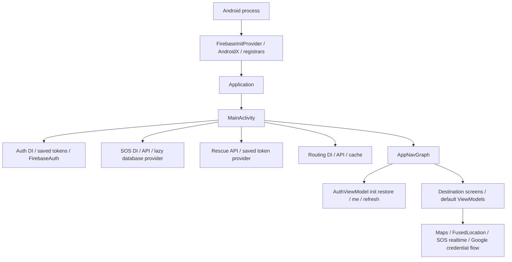

# PHASE 5 – P5-E06-USB: MainActivity & AppNavGraph Isolation

Thực thi 2026-11-08, Asia/Bangkok. **CONDITIONAL overall; actual MainActivity và production AppNavGraph/Auth-navigation scope PASS trên OPPO USB.** Không nghiệm thu full cloud UI/application E2E.

## 1. Executive Summary

Blocker entry/graph đã được gỡ trong standalone package: chạy nguyên source production **MainActivity**, **AppNavGraph**, Splash/Onboarding/Login/Register/About cùng actual AuthRepository/AuthViewModel/storage. Graph vẫn sở hữu toàn bộ27 route, arguments, navigation callbacks và back-stack logic. Screen construction được inject; destinations ngoài subset dùng unavailable UI ghi rõ trong màn hình và báo cáo.

Final physical: **99 unique executions = old76 + new23**, failures/errors/skipped0, mọi instrumentation và driver exit0. Focused6 lặp lại không cộng vào99. Fresh routing462/13suites; full JVM540/30suites; targeted Auth/navigation37/6suites, tất cả0failures/errors/skipped; debug APK build exit0.

```text
MAIN_ACTIVITY_ISOLATED = PASS
PRODUCTION_APP_NAV_GRAPH = PASS (actual graph / tested auth-navigation scope)
PRODUCTION_AUTH_NAVIGATION = PASS (synthetic local fixture)
MAIN_GRAPH_ISOLATION = CONDITIONAL (unavailable screen factories outside tested subset)
OLD76_PHYSICAL_REGRESSION = PASS
NEW23_PHYSICAL_NAVIGATION = PASS
MAPS_UI = NOT_RUN
SOS_UI = NOT_RUN
RESCUE_UI = NOT_RUN
ROUTING_UI = NOT_IMPLEMENTED
FULL_APPLICATION_E2E = NOT_RUN
REAL_FIREBASE_SDK_CLEANUP = NOT_RUN
F06 = OPEN
STRICT_ROUTING_DISABLED
FINAL_ACCEPTANCE = CONDITIONAL
```

[Actual JUnit99](../tools/ui-harness/evidence/p5e06-usb/physical-final/TEST-production-ui.xml), [commands/results](../tools/ui-harness/evidence/p5e06-usb/physical-final/results.json), [group counts](../tools/ui-harness/evidence/p5e06-usb/coverage-groups.json). PASS labels above refer to this scoped runtime, not production-server authentication or rescue authority.

## 2. Laptop/Phone Disk Gate

Before: `/` free8,331,919,360bytes (~7.8G), `/home` free10,886,873,088bytes (~11G). Phone `/data`108G total/100G used/**8.3G available**. Root gate>=2,000,000,000bytes PASS and rechecked before major builds. No Docker/Snap/Gradle/SDK/user-data cleanup. [Before receipt](../tools/ui-harness/evidence/p5e06-usb/environment-before.json), [after disk](../tools/ui-harness/evidence/p5e06-usb/disk-after.txt), [phone receipt](../tools/ui-harness/evidence/p5e06-usb/device-and-cleanup.json).

Java25.0.4.1, Gradle9.7.1; AGP9.4.0 and Kotlin Compose plugin2.2.10 unchanged. Gradle's bundled Kotlin2.4.0 is not a plugin upgrade. Every build offline/no-daemon; no dependency/SDK download. [Versions](../tools/ui-harness/evidence/p5e06-usb/tool-versions.txt).

## 3. Physical USB Device Inventory

Actual `adb devices -l`: exactly one authorized physical USB phone, **OPPO CPH2159 / Android13 / API33**, boot_completed1, ro.kernel.qemu not1. Serial selected dynamically from USB inventory, used in all device commands, persisted as REDACTED. No emulator substitution or system-dialog interaction. Root permission, firmware and global settings untouched.

API37 ACCESS_LOCAL_NETWORK runtime permission scenarios remain NOT_APPLICABLE on API33; five API37-only old cases and screenshot scenario are outside old76 as in E05. No grant/revoke command in physical mode. Current API33 results do not certify API37 permission behavior.

## 4. Repository Baseline

Android `/home/vantri/AndroidStudioProjects/bai1`; Backend `/home/vantri/AndroidStudioProjects/canh-bao-thien-tai-backend-app` READ ONLY. Read E05/E04/E03/E02/E01R reports and relevant source/manifests. Checked pwd/status/diff-check and ancestors/repo AGENTS.md; no applicable AGENTS found. Existing dirty/untracked changes preserved.

Pre-edit SHA-256/mtime_ns snapshot: **1,030 Android files,677 Backend files**, including untracked source/docs/evidence. Excluded generated/environment directories `.git/.gradle/build/dist/node_modules/.idea/.kotlin`; IDE changes are not claimed immutable by this snapshot. Android **1,021 unchanged**, exactly9 baseline files edited,0missing;10 new implementation/test source files plus this report/evidence. Backend677 unchanged and0new/removed. [Baselines](../tools/ui-harness/evidence/p5e06-usb/android-baseline.json), [Android preservation](../tools/ui-harness/evidence/p5e06-usb/android-preservation.json), [Backend preservation](../tools/ui-harness/evidence/p5e06-usb/backend-preservation.json). No reset/clean/restore, commit/push/deploy.

## 5. Production Startup Dependency Audit

Production before this task:



| Component | Auto SDK / credentials | Network / realtime | Deferral and injection / actual source in isolated APK |
|---|---|---|---|
| FirebaseInitProvider, ComponentDiscoveryService, analytics/GMS services | Provider SDK startup before Activity; persisted Firebase state possible | SDK-dependent Internet effects possible, unsafe on phone | Excluded with all Firebase/GMS dependencies from standalone build; unchanged in main debug/release |
| AndroidX Startup/ProfileInstaller, FileProvider | AndroidX initializers; no Auth credential ownership | Startup work; FileProvider grants URIs only when used | Standalone startup provider/receiver removed; no FileProvider; main unchanged |
| Application/MainActivity | Before: four eager DIs; after: MainAppHost binding | Production Auth/Routing still initialized; SOS/Rescue deferred | Production DisasterApplication vs isolated GraphFixtureApplication; exact MainActivity copied |
| Auth DI/AndroidFirebaseAuthSession | Real SharedPreferences + FirebaseAuth.getInstance | Actual backend me/refresh/custom token; SDK account sync | Production unchanged; standalone injects actual repository/storage with no-cloud adapter and pinned fixture |
| SOS DI/FirebaseSosRepository | Lazy databaseProvider, manual DI still unsafe if reachable | observeSos/observeRealtimeSos/getSosById starts realtime collector | Production construction only on dependent screen; isolated bindings/classes excluded |
| Rescue DI/default mission ViewModels | Token provider/default DI | Rescue API and SOS dependency | Deferred in production screen binding; excluded standalone |
| Routing DI | Own token provider/cache, no rescue authority granted | Production API available when explicitly used | Production unchanged; standalone injects actual download-only repository/pinned client |
| Login production overload | CredentialManager and Google/Firebase on Google-button click | Google/Firebase + backend Google endpoint | Default overload preserved; standalone actual Login UI requires injected no-cloud click callback |
| Graph logout | Credential cleanup callback | Production CredentialManager default cleaner | Core requires CredentialStateCleaner; standalone counter adapter; production wrapper preserves SDK default |
| Map/location/SOS/rescue destinations | GoogleMap/FusedLocation/default VMs | API, realtime, location/SOS paths | Screen construction only through production factory; isolated unavailable UI; production UI NOT_RUN |
| DisasterRepository role sync | In-memory role/data; no SDK | No Internet/realtime | Production callback unchanged; isolated no-cloud role sink |
| Splash/Onboarding/Register/About | UI/resources only | No cloud dependency | Exact source/resources copied; actual runtime tested |

Actual main/debug/release merged components audited; metadata values/secrets not copied into report. [Production manifest audit](../tools/ui-harness/evidence/p5e06-usb/audit/production-manifest-audit.json). Removing only FirebaseInitProvider would have left manual SDK/DI/default screen paths and was insufficient.

## 6. Manifest/Provider Isolation Strategy

Standalone Gradle project applies no google-services plugin and includes no Firebase/GMS/CredentialManager dependency. Its Application is **GraphFixtureApplication**, no provider/service/receiver/SDK metadata. Target has exactly two non-exported Activities without intent filters: legacy IsolatedUiActivity for unchanged old76 wiring, actual MainActivity for new graph tests. allowBackup=false, cleartext base=false and actual debug network config retained.

Separate test APK has the AndroidX instrumentation runner targeting only the isolated package; framework bootstrap/empty Activities and REORDER_TASKS permission are AndroidX test infrastructure, not production startup/cloud components. No test providers/services/receivers or custom cloud Application. Both APK DEX cloud gates PASS. [Target manifest](../tools/ui-harness/evidence/p5e06-usb/isolated-target-manifest.xml), [test packaged manifest](../tools/ui-harness/evidence/p5e06-usb/isolated-test-manifest.xml).

Main manifest now names DisasterApplication; Firebase/AndroidX/FileProvider/GMS registrations and Maps metadata remain production defaults, including release. The main APK was never installed/launched. Final release manifest regenerated with processReleaseManifest, exit0, not inferred from stale artifacts.

## 7. Minimal DI/Screen Factory Design

MainActivity casts its manifest-selected Application to **MainAppHost**, invokes initialize and AppGraph inside its existing edge-to-edge/theme/Surface/rememberNavController structure. It no longer imports service DI or SDK constructors. DisasterApplication initializes actual Auth/Routing and calls the preserved default AppNavGraph overload. SOS/Rescue initialization moved to production bindings when a related destination is entered; defaults still use original production screens/default ViewModels.

Core AppNavGraph requires AuthViewModel, AppNavScreens, CredentialStateCleaner and role callback. All27 route declarations, arguments and navigation lambdas remain in this exact production source. The23-method screen interface only constructs screens; it does not register a NavHost or decide route transitions. ProductionAppNavGraph preserves the original call signature/default Auth VM and CredentialManager behavior. No test flag, synthetic credentials or routing bypass enters production source.

Three scoped navigation corrections: revoked/error session on protected route navigates Login with cleared history; protected screen factories cannot render while restore is unresolved/unauthenticated; role-selection completion pops its own entry (the login entry was already removed after authentication). Public onboarding/password-recovery/About routes remain accessible. Existing/new-user destination semantics preserved. Four JVM policy tests plus actual physical graph tests cover these corrections.

Standalone GraphFixtureApplication owns pinned HTTP/storage/repository, provides actual Activity-scoped AuthViewModel via Compose viewModel, and invokes actual AppNavGraph. It supplies explicit unavailable factory methods outside Login; actual Splash/Onboarding/Register/About remain direct core calls. This is a construction seam, not a replacement test NavHost. [Route preservation](../tools/ui-harness/evidence/p5e06-usb/audit/route-preservation.json).

## 8. Exact Source Changes

Nine edited baseline files and ten new implementation/test files are listed below. Before/after mtime_ns in preservation JSON. All prior user/task changes outside these files retained. Report/evidence additions are enumerated in [exact final manifest](../tools/ui-harness/evidence/p5e06-usb/changed-files.json).

| File | Before SHA-256 | After SHA-256 |
|---|---|---|
| `app/src/main/AndroidManifest.xml` | `b98c9e60f57e44345f1b4ba4d95ea5d0a3ea3a984d7062790e1dfb0022f99454` | `bbd5997622eda9a7061cc7bb1d7799a9a694d7bfdbc6d9d72f9a564944d20dfc` |
| `app/src/main/java/com/example/bai1/MainActivity.kt` | `6e0deee5f6143bf3228ebea191c4e4809e747264d5eb90de833da06677e6067c` | `3676ad28103d77b1f7fb28b37f14893ce4a2d45c0e866326a04497fccd1e641c` |
| `app/src/main/java/com/example/bai1/presentation/navigation/AppNavGraph.kt` | `5c6223d1030cd3ce35aa4277a4914305f287dc85c4d52954cc711700a0300ed3` | `a5c75fab7628fc446e9474c87ae520da374ec471f39ac7e28e28e04bcbb2aa3a` |
| `tools/ui-harness/README.md` | `dd9892784f2ab9963e6a3d5ab82ce9d06c432b13128a819988b61b6b6e047667` | `600c127d15c04d7152f062af28703d506286fa09c86237e90e9e1fca8200ee14` |
| `tools/ui-harness/build.gradle.kts` | `2c39915fd6d0cf9d97543f304a3ea9c848d47e030835443ac32d1e2ab0d72f20` | `f19f21919d89e56617b8e5882907f3264be90e0cceca582982438c8e81d834a6` |
| `tools/ui-harness/host_fixture.py` | `daba48c82bb4432d7f15de4b179fc8802de90ef9f5a7c04c2ed4475ed57923cc` | `e18f7f04321775363931fcd07c7da02946d8e9f0c243dab51a83bbcada1d4761` |
| `tools/ui-harness/run_ui_tests.py` | `ddc04a87c791d79785e5fffa5bc316904cd8b6141d555f966692bb61c89cc954` | `afedc2b0945b34d0fb49dca2b59e12159edacae5355dd902d2482d1edb15eccf` |
| `tools/ui-harness/src/androidTest/java/com/example/bai1/fixture/ProductionSubsetUiTest.kt` | `0916ec796675340308f9ead66c293621f89b0baed848d95322c898a7115788b8` | `073ae701e57f41a62c966d9313ee635dd9a06a672f3054b26f0919803e319400` |
| `tools/ui-harness/src/main/AndroidManifest.xml` | `61a651ae071dd54a3c825141f8c3b82cc14f2a46aabf53e69fd0b924c9488ee3` | `8abec7610339a32f77089f6a1851162a9f505a1a437120774ae7c54db1407274` |
| `app/src/main/java/com/example/bai1/DisasterApplication.kt` | NEW | `b251630069702f43ec2e408d91fdd896f0ffaf7356c3008511becbec908d8895` |
| `app/src/main/java/com/example/bai1/MainAppHost.kt` | NEW | `167b4cac44d411b69bdf02f83401b42e8e21394b21a53d4a31ce43fde3a77779` |
| `app/src/main/java/com/example/bai1/presentation/navigation/AppNavScreens.kt` | NEW | `f1a79e979dc42c9503f71af2c788fa4d3fb188cad576b670cd7414c99a861221` |
| `app/src/main/java/com/example/bai1/presentation/navigation/ProductionAppNavScreens.kt` | NEW | `b3effc947219427936361d5b50a472920e355fa449888d7bcc0b26d0a32066bf` |
| `app/src/main/java/com/example/bai1/presentation/navigation/ProductionAppNavGraph.kt` | NEW | `19f1e91d8cfc34ac6a4d991192bc5fdf3d8f5cb24aad46ea70d74889df80c609` |
| `app/src/main/java/com/example/bai1/presentation/navigation/AuthNavigationPolicy.kt` | NEW | `6e9e9049f8ba3a688424f68772416327b8069f8283b85fc7a6c1a9c965cb32da` |
| `app/src/test/java/com/example/bai1/presentation/navigation/AuthNavigationPolicyTest.kt` | NEW | `3ee2a9ab5e600313d25ebe588716d0b5d9b387efc67d0402aab1a40260447ad7` |
| `tools/ui-harness/src/main/java/com/example/bai1/uiisolated/GraphFixtureApplication.kt` | NEW | `f586011e3be3e7c145b1d19e3f1d5e0ddb059dc7188ae779a5e10bd1a70b0287` |
| `tools/ui-harness/src/main/java/com/example/bai1/uiisolated/GraphFixtureScreens.kt` | NEW | `2999c7733472ad01fe9219f3c44fb69865d8d675c16e37e2f17775f192c3bfd0` |
| `tools/ui-harness/src/androidTest/java/com/example/bai1/fixture/ProductionGraphUiTest.kt` | NEW | `27ad7e9b12778743f6c94046e24b70b15dd6b1ffe5d1998ac4d0c66e46f30f5d` |


Old ProductionSubsetUiTest changes only its obsolete forbidden class inventory: now production Application/default screen factory are forbidden instead of the newly permitted actual MainActivity/core graph. Firebase/Auth DI/SOS/SDK absence and all auth/routing/validation expectations remain. No test dropped; names matched against E05 actual76 results.

## 9. Isolated Application Package Proof

Target `com.example.bai1.p5e02.uiisolated`, test `.test`; no installation into `com.example.bai1`. Both owned namespaces checked absent before each run; install -t without -r. Android assigns separate package data/UID; no sharedUserId. Only synthetic sessions in the newly installed package's actual SharedPreferencesTokenStorage. Initial storage reset touches only this owned package; ordered restart pairs preserve its own storage. No production saved account, credential restore or fallback URL.

Target APK SHA-256 `daf842050a1a89ebcbcfc3b1bba535b4890a1d9fe249badf6937bb8cf871cd49`; test APK `05fe11d1f98e703d2247434dc52b311bf9018bca7f1f3ec11e7b1c54b23b55b9`. Initial package absence, APK digest, individual commands and cleanup recorded in final results. Do not equate source namespace `com.example.bai1` with install applicationId; it allows exact production class names in a distinct sandbox.

## 10. DEX/Manifest/Network Isolation Evidence

Before install, driver asserts target manifest package/Application/component/permission allowlist, non-exported activities, backup and platform policy; target and instrumentation DEX contain no Firebase/GMS/CredentialManager SDK, production Application/default factory/DI/SOS client. Exact MainActivity/AppNavGraph/Auth/UI/storage/client classes required present. **26 Kotlin production copies byte-equal**; exact shared lifecycle test copy hash verified. Direct routing source directories remain originals with unchanged baseline hashes.

Explicit startup wiring audit requires MainActivity->MainAppHost and isolated Application->actual AuthRepository(no-cloud/pinned client)/actual graph. Production binding sources excluded, no BuildConfig production URL fallback, literal host fixed127.0.0.1 with validated OS-assigned port. Source configuration values from google-services JSON checked against target DEX without exposing values:7checked,0matches. No Firebase database URL literals. Main APK separately verified to retain production bindings/providers and exclude isolated classes/fixture credential literals.

All HTTP clients deny proxies, redirects and automatic retry, pin scheme/host/port/path; no forwarding or real Backend. Request Host metadata audited to exactly the owned loopback origin. Manifest+DEX+source construction+request destination jointly support the tested isolation; no claim of a device-wide network firewall. [Startup/origin gate](../tools/ui-harness/evidence/p5e06-usb/physical-final/startup-origin-audit.json), [copy hashes](../tools/ui-harness/evidence/p5e06-usb/physical-final/source-copy-hashes.json), [shared test hash](../tools/ui-harness/evidence/p5e06-usb/physical-final/lifecycle-test-copy-hash.json), [main APK boundary](../tools/ui-harness/evidence/p5e06-usb/audit/main-apk-boundary.json).

## 11. USB Fixture and ADB Reverse

Laptop fixture binds127.0.0.1 and port0 (OS chooses port), phone uses matching127.0.0.1 through its owned ADB reverse. Existing mappings empty; collision gate before creation. No port3000, LAN server, production Backend process or emulator bridge used for phone. Sanitized fixture events include method/path/Host/mode/barrier/bearer_present, never request body/password/token.

Supports login/register/me/refresh/custom-token envelope,200/401/403/500, actual socket timeout/reset/offline, controlled barriers, strict=false download-only GZIP. Added explicit synthetic expired-access header for me401, preserving old fixture modes. Per-case barrier registry reset and finally-release retained. No email/SOS/push/cloud forwarding.

Device commands use the discovered serial (redacted here):

```text
adb -s <discovered_USB_serial> reverse tcp:<owned-port> tcp:<owned-port>
adb -s <discovered_USB_serial> install -t <owned-isolated-apk>
adb -s <discovered_USB_serial> shell am instrument -w -r -e class <actual-test-class>#<method> ... <isolated-test-package>/<runner>
adb -s <discovered_USB_serial> logcat --pid=<owned-pid> -v threadtime -T <test-window>
adb -s <discovered_USB_serial> reverse --remove tcp:<owned-port>
adb -s <discovered_USB_serial> uninstall <newly-installed-owned-package>
```

Final exact ports/commands are recorded per case in results.json, with serial REDACTED. No reverse --remove-all, install -r, pm clear or global logcat clear.

## 12. Production MainActivity Runtime

New23 launch the exact production MainActivity class through ActivityScenario, not IsolatedUiActivity. Manifest-selected isolated Application supplies host bindings, no cloud constructor. Startup test requires MainActivity/AppNavGraph class availability and absence of production/default cloud classes, empty owned session,0no-cloud sign-ins. MainActivity source has no DI/SDK import. Logs show actual class lifecycle under isolated PID.

The main application's **production Application/SDK providers were not launched**. MAIN_ACTIVITY_ISOLATED=PASS is the actual Activity source with isolated dependencies; real production SDK startup/cleanup remains NOT_RUN.

## 13. Production AppNavGraph Runtime

Exact source-copy and DEX class gates plus real MainActivity->host->AppNavGraph wiring establish actual graph execution. All27 registered routes/order match pre-edit source. Tested actual route transitions and current back-stack entries, not just screenshot text. Screen factories retain original navigation callbacks; no test NavHost replaces the graph.

PRODUCTION_APP_NAV_GRAPH=PASS for exercised auth/navigation subset. Home/Profile/Settings/role selection/Map/SOS/Rescue destinations use labelled unavailable UI and therefore only graph routing/callbacks are certified. Other factory destinations are not covered by current runtime tests.

## 14. Authentication Navigation Tests

Actual Login UI submits synthetic credentials to production repository/ViewModel/pinned HTTP client, me/custom-token synchronization through no-cloud adapter, then actual graph selects Home. Actual Register UI submits and graph selects role-selection; its actual callback reaches Home with role entry removed. Splash restored session selects Home. Synthetic success does not authorize routing; routing status canNavigateSafely remainsfalse.

Profile/Settings unavailable factory buttons invoke actual graph logout lambdas: VM local revoke, routing memory invalidation, injected credential clear, Login with protected history removed. Direct synthetic expiry/local revoke and server me401+refresh401 both return Login. These are fixture Auth/navigation results; real Google/Firebase/backend login NOT_RUN.

## 15. Back Stack/Recreate/Restart Tests

Onboarding replaces Splash, Login replaces Onboarding; Register pushes and its actual back callback returns Login. Auth boundaries clear forms/protected history; popBackStack after logout cannot expose Home. Settings->actual About->back returns Settings using actual graph callbacks; settings logout clears stack. Unauthenticated attempt to enter Map cannot construct the unavailable screen, and routes back to Login (construction counter remains empty).

Activity recreation covers authenticated Profile, logout then Login recreation, and unauthenticated Register history. Actual Activity-scoped VM identity and no extra token write are asserted. Force-stop/relaunch ordered pairs assert **distinct PIDs** for both saved-session restore and rejected-expiry restart, plus old E05 pairs. Expired restart emits no auth HTTP and cannot recover stale tokens. [Restart receipts](../tools/ui-harness/evidence/p5e06-usb/coverage-groups.json).

## 16. Old76 Physical Regression

**76/76 unique old methods PASS**, actual Android JUnit executions,0failures/errors/skipped, all ADB exit0. Set equality/subset audit against E05 final actual results prevents omissions. Includes old44 UI/network/cache/validation,12HTTP lifecycle cases and20shared repository tests executed inside Android process. Exact shared production test copy unchanged. No security assertion weakened; only class inventory adapted as explained in section8.

[Old76 runtime XML](../tools/ui-harness/evidence/p5e06-usb/TEST-old76.xml). API37-only exclusions unchanged; no emulator/JVM result substituted for a physical case.

## 17. New Physical Navigation Tests

**23/23 new unique actual graph cases PASS**,0failures/errors/skipped, all ADB exit0. Six focused repetitions PASS but excluded from99unique total. [New23 runtime XML](../tools/ui-harness/evidence/p5e06-usb/TEST-new-graph23.xml).

| Actual physical JUnit method | Result | ADB exit |
|---|---|---:|
| graphActualMainStartupAndManifestHaveNoCloud | PASS | 0 |
| graphOnboardingLoginRegisterBackStackUsesActualCallbacks | PASS | 0 |
| graphActualLoginHomeProfileLogoutClearsProtectedHistory | PASS | 0 |
| graphActualRegisterNewAccountSelectsRoleThenHome | PASS | 0 |
| graphSettingsAboutActualUiBackThenLogout | PASS | 0 |
| graphSessionExpiryClearsNestedBackStackToLogin | PASS | 0 |
| graphRefreshRejectedReturnsLoginAndClearsRouting | PASS | 0 |
| graphActivityRecreatePreservesAuthenticatedRouteAndVm | PASS | 0 |
| graphUnauthenticatedRecreateKeepsRegisterHistory | PASS | 0 |
| graphPrepareSavedSessionForProcessRestart | PASS | 0 |
| graphSavedSessionSurvivesProcessRestartThroughActualSplashGraph | PASS | 0 |
| graphPrepareExpiredSessionForProcessRestart | PASS | 0 |
| graphRestartAfterExpiryNeverRestoresProtectedRoute | PASS | 0 |
| graphHttp401KeepsLogin | PASS | 0 |
| graphHttp403KeepsLogin | PASS | 0 |
| graphHttp500KeepsLogin | PASS | 0 |
| graphSocketTimeoutKeepsLogin | PASS | 0 |
| graphOfflineKeepsLogin | PASS | 0 |
| graphMissingReverseKeepsLogin | PASS | 0 |
| graphLateLoginAfterLogoutCannotNavigateHome | PASS | 0 |
| graphProtectedRouteCannotRenderWithoutSession | PASS | 0 |
| graphUnavailableMapSosRescueAreOnlyGraphRoutingCoverage | PASS | 0 |
| graphCredentialButtonUsesOnlyInjectedNoCloudLauncher | PASS | 0 |


Initial standalone compile attempt lacked ANDROID_HOME and failed before install/tests; corrected by using existing SDK path, no download/config upgrade. Corrected compile-only build, focused6 and final99 passed. [Tooling logs](../tools/ui-harness/evidence/p5e06-usb/development-tooling/), [exit codes](../tools/ui-harness/evidence/p5e06-usb/exit-codes.json). No hidden failing final test.

## 18. Auth Lifecycle Regression

Production AuthRepository/AuthViewModel/FirebaseAuthSession/AndroidFirebaseAuthSession/credential interface retain E05 hash and mtime. Old lifecycle tests re-executed on phone; late login/refresh/restore after logout, current epoch/concurrent login/stale failure, VM cancellation/ownership, adapter cleanup uncertainty and routing invalidation remain PASS. HTTP cases use observed host entered/release barriers and actual completion joins/write counts. New graph stale completion test also waits actual VM jobs after host release and asserts no write/route resurrection.

Focused JVM **37tests/6suites** covers Auth suites plus new policy;20 shared deterministic repository cases and3VM lifecycle cases included. NoCloud counters/throws/serialized effects certify injected orchestration only. **REAL_FIREBASE_SDK_CLEANUP=NOT_RUN**, including external production Google credential bridge/process-death/cloud SDK account behavior. CleanupPending uncertainty semantics not upgraded to real SDK success.

## 19. Routing JVM Regression

Fresh `--rerun-tasks --tests 'com.example.bai1.rescue.routing.*'`: **462tests/13suites,0failures/errors/skipped,exit0**, all27Gradle tasks executed. Routing source/tests/platform policies retained baseline hash/mtime; strict policy untouched. [Routing XML](../tools/ui-harness/evidence/p5e06-usb/jvm-build/routing-xml/), [log](../tools/ui-harness/evidence/p5e06-usb/jvm-build/routing.log).

## 20. Full JVM Regression

Full `:app:testDebugUnitTest`: **540tests/30suites,0failures/errors/skipped,exit0**. Historical536 plus4new navigation policy cases; counts from execution XML, not assumed baseline. Auth targeted and routing counts overlap full suite and are not added. [Full XML](../tools/ui-harness/evidence/p5e06-usb/jvm-build/full-xml/), [results/commands](../tools/ui-harness/evidence/p5e06-usb/jvm-build/results.json).

```bash
export JAVA_HOME=/usr/lib/jvm/java-25-openjdk-amd64
export PATH="$JAVA_HOME/bin:$PATH"
cd /home/vantri/AndroidStudioProjects/bai1
java -version
./gradlew --offline --no-daemon --version
./gradlew --offline --no-daemon :app:testDebugUnitTest --tests 'com.example.bai1.auth.*' --tests 'com.example.bai1.presentation.navigation.*'
./gradlew --offline --no-daemon :app:testDebugUnitTest --rerun-tasks --tests 'com.example.bai1.rescue.routing.*'
./gradlew --offline --no-daemon :app:testDebugUnitTest
./gradlew --offline --no-daemon :app:assembleDebug :app:processReleaseMainManifest
./gradlew --offline --no-daemon :app:processReleaseManifest
PYTHONDONTWRITEBYTECODE=1 python3 tools/ui-harness/run_ui_tests.py --physical-usb --evidence-dir /tmp/p5e06-final-physical
```


## 21. APK Build

Main debug APK BUILD SUCCESSFUL, exit0, **95,443,782bytes**, SHA-256 `2f3b59151f237da4ffcf7690d95394482a4094fcb5067050a7217877bec13a1e`; not installed. Standalone target/test build PASS before install. Production defaults/fixture exclusion audited independently. Release final merged manifest build exit0; release runtime not run. Build success is not used as device acceptance. [APK log](../tools/ui-harness/evidence/p5e06-usb/jvm-build/apk.log), [release manifest log](../tools/ui-harness/evidence/p5e06-usb/release-manifest.log).

## 22. Logcat/Crash/Privacy

Only isolated PID and per-test time window collected; no global clear/other-app log read. All own logs reviewed:0fatal/ANR markers,0unexpected Firebase/credential startup markers,0fixture password/token literal leaks. OPPO caught receiver-not-registered teardown warnings are not fatal/ANR evidence. Manifest/DEX/source/allowlisted request audit supports absence of production cloud/SOS path; logs alone do not establish universal network absence. No screenshots of personal content.

[Log review](../tools/ui-harness/evidence/p5e06-usb/log-review.json), actual per-case owned-process-logcat.txt under physical-final. Serial redacted in persisted commands/metadata; fixture bodies/Authorization values never recorded.

## 23. Personal Phone Preservation

No factory reset/root/flash/global settings/account login/location/camera/SMS permission grants, no real SOS/location/email/push. No private photos/accounts/messages/other-app storage accessed. Force-stop affects only newly installed owned target; uninstall only the two previously absent namespaces installed by this task. Existing production app never installed/replaced/launched/cleared. Cleanup removes only owned reverse mapping, releases barriers/stops server; final target/test package paths absent, reverse list empty, cleanup_errors empty, phone still authorized device. [Cleanup receipt](../tools/ui-harness/evidence/p5e06-usb/device-and-cleanup.json).

## 24. Backend/Graph Preservation

**677/677 Backend baseline files unchanged SHA-256 and mtime_ns,0new/removed**, including **20 graph/manifest/import-diagnostic/GZIP artifacts** across output directories. Backend strictly read-only; no server run, edits, deployment or production traffic. Android routing27 source files, SOS21 source files, Rescue network files, Google services config, main/debug network security XML and historical evidence unchanged. Existing dirty state retained; whole git diff is not misattributed to this task.

[Backend preservation and artifact paths](../tools/ui-harness/evidence/p5e06-usb/backend-preservation.json), [Android exact hashes](../tools/ui-harness/evidence/p5e06-usb/android-preservation.json), [evidence index](../tools/ui-harness/evidence/p5e06-usb/evidence-index.json).

## 25. Remaining Cloud-dependent UI Blockers

Production Maps/SOS/Rescue/Home/Profile/Settings/role-selection and password-recovery/OTP/reset factory screens were not exercised as production UI. Unavailable factory routing checks are not Maps/SOS/Rescue E2E. Actual Splash/Onboarding/Login/Register/About UI is covered. Production Google account picker/Firebase sign-in, SDK persisted sessions/provider startup/real expiry cleanup, external credential-effect ownership remain NOT_RUN. API37 physical permissions and broad real-network/device matrix remain outside this API33 run.

Production providers intentionally remain active in main APK; future cloud UI work requires a separately reviewed isolation boundary for screen-specific API/realtime/location dependencies. Current standalone artifact cannot safely be generalized to production main package.

## 26. Remaining F06/Parity/P5-I02 Work

F06 OPEN; no qualification/UCS/hazard changes or parity/P5-P01/P5-I02 implementation. No Routing UI. **NO PRODUCTION-AUTHORITATIVE QUALIFICATION => STRICT_ROUTING_DISABLED**. READY/VERIFIED_COMPATIBLE/SHA/edge counts/synthetic login/fixture/Hazard ATTACHED/phone UI PASS grant no rescue authority. Existing cache/network assurance limitations are not resolved by navigation PASS.

## 27. Final Acceptance

**CONDITIONAL — P5-E06-USB** under the task's partial-destination rule. Actual MainActivity and actual production AppNavGraph/Auth navigation now run safely in separate package on real phone, with isolation gates, old76+new23 PASS, fresh routing/full JVM/APK PASS, Backend/artifacts and personal-phone scope preserved. No remaining failing final case.

Entry/core graph no longer BLOCKED, but factory UI outside Auth/Onboarding/Register/About is unavailable, and real production SDK lifecycle is not validated. Thus no unqualified MAIN_GRAPH_ISOLATION/FULL_APPLICATION_E2E PASS. Individual MAIN_ACTIVITY_ISOLATED/PRODUCTION_APP_NAV_GRAPH/PRODUCTION_AUTH_NAVIGATION statuses are PASS only in this explicitly tested scope; Maps/SOS/Rescue UI NOT_RUN, routing UI NOT_IMPLEMENTED, strict disabled.

## 28. Recommended Next Task

Đề xuất một task hẹp cho **production Profile/Settings/role-selection UI dependency injection**, tái sử dụng graph/host seams để thay unavailable UI bằng actual UI với injected Auth repository; bổ sung back-stack/session regression trước khi xem xét Maps/SOS/Rescue. Real Firebase/Google lifecycle cần kế hoạch xác minh riêng, không suy từ no-cloud adapters. Không tự bắt đầu task mới, F06/parity/P5-I02/Routing UI hoặc commit/push/deploy.
