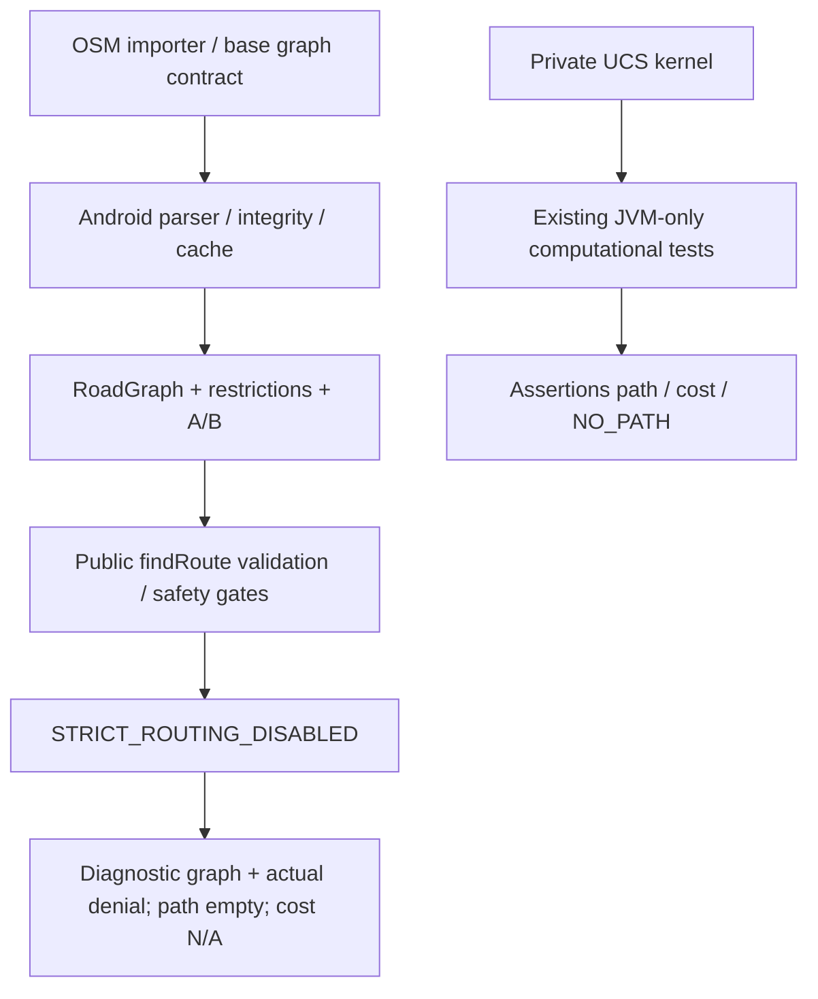

# P5-E09-DEMO — Map, UCS và cứu hộ mô phỏng trên OPPO

Ngày thực thi: 09/11/2026, Asia/Bangkok. Buổi trình bày: **10/11/2026**. **CONDITIONAL — diagnostic/fixture demo; chưa có computed route trên điện thoại.**

1. **Ngày mai có thể demo gì?** APK riêng, graph địa lý offline 8 nút/8 cạnh, chọn A/B, parser và luật rẽ thật, gọi routing public để quan sát từ chối, gửi yêu cầu SOS synthetic tới fixture và hiển thị marker phản hồi. Có kịch bản 3–5 phút và phương án graph offline.
2. **Thuật toán thật nào đang chạy?** Source có **Uniform Cost Search (UCS)** trên edge-based state, priority queue. Kernel được thực thi trong JVM tests có sẵn. **Trên điện thoại public findRoute chỉ chạy validation/safety gates, chưa vào vòng lặp UCS** vì authority còn thiếu.
3. **Bản đồ đã hiển thị kết quả thuật toán chưa?** Diagnostic hiển thị graph input và trạng thái trả về của router thật; **chưa hiển thị polyline từ một path tính được**. Các đoạn xám/đỏ là cạnh đầu vào, không phải route output. Cost N/A; không diễn giải raw default0 thành đường tối ưu0m.
4. **SOS/Rescue mô phỏng đến đâu?** Form test-only gọi exact production ApiSosTransport→OkHttpSosApiClient→owned HTTP fixture, nhận ACTIVE synthetic và marker. UI SOS/Rescue production, mission accept/complete, Firebase/realtime/dispatch chưa nghiệm thu.
5. **Chưa được tuyên bố gì hoàn thiện?** Không Google Maps production, không tính tuyến tối ưu end-to-end trên điện thoại, không dẫn đường cứu hộ an toàn, GPS/cloud/push/dispatch, qualification authority/F06 hoặc Full Application E2E.

## A. Progress summary

```text
ALGORITHM_IMPLEMENTATION = PRESENT (UCS private computational kernel)
ALGORITHM_EXECUTION = PASS (existing JVM computational tests); PHONE SEARCH KERNEL = BLOCKED
GRAPH_INPUT_VALIDATION = PASS (actual parser, valid/invalid input)
MAP_PRODUCTION_UI = NOT_RUN
MAP_DIAGNOSTIC_UI = PASS (offline graph on physical phone)
ALGORITHM_TO_MAP_INTEGRATION = CONDITIONAL (public gate result; no computed path)
RESCUE_UI = TEST_ONLY_FORM_PASS; PRODUCTION_UI_NOT_RUN
SOS_FIXTURE = PASS (actual API client + transport, synthetic local server)
PHYSICAL_USB_TEST = PASS (16 unique cases)
DEMO_READY = CONDITIONAL (diagnostic/fixture rehearsal; shortest-path phone demo blocked)
DEMO_CORE = BLOCKED for computed-route demonstration until an approved path is available
F06 = OPEN
STRICT_ROUTING_DISABLED = true
FULL_APPLICATION_E2E = NOT_RUN
```

Đã ưu tiên P0/P1, không mở rộng Auth/Profile/Settings/warning/notification. Không chạy lại162physical unrelated: **NOT_RUN** trong E09 để tập trung demo; không dùng162E08 làm bằng chứng Map/SOS. Security regression mới: SOS26/7suites, routing462/13suites, fullJVM545/32suites,0fail/errors/skips, tất cảexit0; mainAPK và demoAPK buildPASS.

## B. Thuật toán thực tế và phạm vi tính toán

Source: `app/src/main/java/com/example/bai1/rescue/routing/algorithm/UniformCostSearchRouter.kt` (SHA256 `0e870be17a190cf83981c45f5c4f60e2a01650d05f74dd25d6d42a4633536522`). `findRoute` có overload RoadGraph và RescueRoutingContext; đều fail-closed trước `private executeSearch`. Không thêm API chẩn đoán mở khóa, không reflection gọi kernel trong APK. New adapter không gán VERIFIED_COMPATIBLE/CLEAR/canNavigateSafely=true.

| Thành phần | Thực sự làm gì |
|---|---|
| TypeScript OSM importer | Cắt way thành directed edges tại giao lộ, policy một chiều, geometry xuôi/ngược; Haversine polyline length; metadata/profile restrictions; turn restrictions |
| vehicle-profile/edge-qualifier/qualification | Đánh giá highway/access/physical/legal dimensions; thiếu evidence vẫn UNVERIFIED; không phải shortest-path search |
| Backend RoutingService | Validate manifest, signed download URL, download-only readinessfalse; không tính đường |
| Android parser/download/cache/loader | Validate contract2.1, IDs/references/coordinates/geometry/length, manifest/profile/version, rawGZIP digest/limits, atomiccache, restriction contexts; không cấp qualification |
| UCS kernel | PriorityQueue, bestCost và parent; trạng thái nodeId+incomingEdgeId+restrictionStateId; stale-queue checks; tích hợp via-node index và via-way DFA; dựng path nodes/edges/geometry |
| Public Android router | Validate input rồi từ chối khi chưa đủ authority. Không trả candidate cho demo hiện tại |
| Diagnostic UI | Vẽ graph thực từ model/parser, hiển thị input/result gates và fixture marker; không production Routing UI |

UCS chọn trạng thái có costG nhỏ nhất; tie-break insertion order. Cost cạnh = `lengthMeters × riskMultiplier`; CLEAR1, FLOODED50 chỉ sau trusted/fresh flood validation. Tổng cost là **weighted meters**, không phải ETA. Bỏ invalid/nonfinite/negative edges; UNKNOWN/BLOCKED và non-VERIFIED không được đi; turn restrictions và geometry guard là điều kiện bổ sung. Kernel trả NO_PATH nếu queue cạn, INVALID_INPUT/GRAPH_UNAVAILABLE trướcsearch; publicAPI có thể trả STRICT_ROUTING_DISABLED trước khi xét connectivity.

Vehicle: importer có profileRESCUE_TRUCK_4X4 (height3m,width2.2m,actualWeight5t,rating5.5t,axle3t và margins). Runtime router không tự đo kích thước xe; sử dụng compatibility metadata. Demo chỉ khai báo tênprofile và UNVERIFIED, **không chứng minh xe đã đạt width/height/load constraints**. Fresh routing tests giữ các guards cũ; không chạy pipeline approval production.

### Sơ đồ đúng với entry đang chạy



**Không có mũi tên từ public gate bị từ chối sang private kernel.** Graph demo không dùng production graph artifact; địa lý và request đều SYNTHETIC_TEST_DATA.

### Ví dụ số từ actual kernel tests

Existing `testMultipleRoutesLowestCostSelection`: A–B–D=10+15=25; A–C–D=5+30=35; A–E–D=12+10=22. Assertions chọn `[A,E,D]`, cost22. Điều này phân biệt UCS tối ưu tổng chi phí với chọn tham lam cạnh đầu5. `testDirectClearRoute` asserts `[A,B]`, cost150/distance150. Đây là synthetic unit fixtures được helper `P5A01RComputationalInspection.kt` inspect private kernel **chỉ trong src/test**, sau khi assert public API từ chối cùng request. Helper và test qualifications không đưa vào demo APK.

Bằng chứng mới: [Actual UCS JUnit XML](evidence/jvm-build/routing-xml/TEST-com.example.bai1.rescue.routing.UniformCostSearchRouterTest.xml), [evidence/algorithm-test-examples.json](evidence/algorithm-test-examples.json). Source tests không sửa.

### Dataset trên điện thoại

| Thuộc tính | Giá trị |
|---|---|
| INPUT GRAPH | SYNTHETIC_TEST_DATA_E09_normal,8nodes/8directededges |
| START / DESTINATION | A→B; UI đổi C/H, H không có cạnh nối |
| VEHICLE PROFILE | RESCUE_TRUCK_4X4, chỉ tênprofile, chưa qualified |
| ALGORITHM / FUNCTION EXECUTED | UniformCostSearchRouter.findRoute public; TurnRestrictionIndex.checkTransition |
| TRAVERSAL CONSTRAINTS | AllUNVERIFIED; unknownroad; synthetic blockedAC/cấmAC→CB |
| COMPUTED RESULT | STRICT_ROUTING_DISABLED; path[]; visited0 |
| COST VALUE / UNIT | N/A cho route bị từ chối; inputedge lengths bằngm |
| QUALIFICATION STATUS | Unverified; no production authority |
| NAVIGATION ALLOWED | FALSE |

Input edge lengths bên dưới được lấy từ output instrumentation thật; adapter dùng hàm Haversine hiện có `distanceMeters` để tạo input. Không gọi các con số này là tổng route cost.

| Edge | Input length(m) | Condition / Compatibility |
|---|---|---|
| AC | 154.219 | UNKNOWN / UNVERIFIED |
| CB | 213.720 | UNKNOWN / UNVERIFIED |
| AD | 106.861 | UNKNOWN / UNVERIFIED |
| DE | 106.861 | UNKNOWN / UNVERIFIED |
| EB | 154.219 | UNKNOWN / UNVERIFIED |
| AF | 123.366 | UNKNOWN / UNVERIFIED |
| FG | 160.292 | UNKNOWN / UNVERIFIED |
| GB | 246.732 | UNKNOWN / UNVERIFIED |

[evidence/actual-on-phone-output.json](evidence/actual-on-phone-output.json) chứa output thật; rawDefaultCost0 chỉ là default data-class khi denied, không phải kết quả tối ưu.

### Hazard contract finding

`StreamingRoadGraphParser.parseEdge` **không đọc JSONcondition và khởi tạo CLEAR** cho basegraph. Điều này thuộc baseline/F06, không sửa trong E09. Initial demo fixture đã phát hiện mismatch qua test BLOCKED thất bại. Adapter được sửa: parse cấu trúc thật rồi **test-only conservative overlay** copy mọi cạnh thànhUNKNOWN, hoặcAC→BLOCKED theo scenario. UI ghi Overlay TEST-ONLY. Không có livehazard/freshness pipeline production; không tuyên bố đây là remediation F06.

## C. Map và SOS dependency audit

Production `DisasterMapScreen` tạo AndroidLocationProvider/GoogleMap, permission launcher, production SOS/rescue defaults; `DisasterMapViewModel` observeSOS và RESTrefresh mỗi4s. Không mang SDK/key/provider đó vào harness. Canvas offline dùng RoadGraph/RoadNode/RoadEdge đã parse, chọnA/B thật, edgeblockedđỏ, marker từ SOSresponse. Không maptiles hoặc GPS.

Production `SOSScreen` và `SosRescueRequestScreen` tự xin permission; ViewModel defaultfactory khởi tạo productionDI/location/photo dependencies. Production SOS UI **NOT_RUN**; không gọi đó là UI đã cô lập. Demoform riêng dùng exact production domainmodel, ApiSosTransport, OkHttpSosApiClient, không repositoryFirebase. RescueMissionAPI có nearby/list/create/respond/status workflows, nhưng không được demo approval/accept/complete hay dispatch. Chưa có source nối SOS location vào production route search; ở demo chỉ dùng nodeđích tọa độTEST cho SOSrequest và phản hồi marker.

Transport fixture chỉ nhận syntheticcondition, coords trong vùngtest, adults1..10 và faketoken không phảiJWT. Success201 trả ACTIVE synthetic, noDBwrites/forwarding/push/email/SMS. Fault403, timeout và offline được test. Epoch test-only chặn late response sau logout; authtoken chỉ memory, restart yêu cầu đăng nhập lại, riêngcổnglocal được lưu vào prefs task.

## D. Actual physical evidence và regression

Device mới xác minh: CPH2159, API33, physicalUSB/authorized, dynamicserialREDACTED. [evidence/environment-before.json](evidence/environment-before.json). **16 unique runtime cases**,0fail/errors/skips, mọiADBinstrumentationexit0. Focused/development runs không cộng vào16.

| Actual JUnit method | Result |
|---|---|
| offlineGraphRendersWithoutTilesGpsOrLogin | PASS |
| actualPublicRouterRunsFromUiAndRemainsDenied | PASS |
| selectedStartAndDisconnectedDestinationUpdateInputNotInventPath | PASS |
| blockedRoadUpdatesGraphAndRunsPublicGateAgain | PASS |
| actualTurnIndexChangesFromAllowToDenyWithoutNavigationAuthority | PASS |
| malformedGraphRejectedByProductionParserAndUiDisablesAnalysis | PASS |
| missingNodeEmptyGraphAndVehicleUnknownRemainFailClosed | PASS |
| actualSosTransportSendsSyntheticFormAndPlacesReturnedMarker | PASS |
| sosHttp403RejectedByActualClientAndTransport | PASS |
| sosTimeoutDoesNotCommitLateSuccess | PASS |
| sosOfflineFailsLocallyWithoutSyntheticSuccess | PASS |
| logoutDuringPendingSosCannotCommitAndBackReturnsLogin | PASS |
| ownBackFromSosReturnsDiagnosticWithoutDispatch | PASS |
| demoPrepareForProcessRestart | PASS |
| demoRestartUsesOwnPortButNoAuthSession | PASS |
| activityRecreationDoesNotRestoreAuthOrGrantRoute | PASS |

[evidence/physical-final/TEST-demo.xml](evidence/physical-final/TEST-demo.xml), [evidence/physical-final/results.json](evidence/physical-final/results.json), [evidence/physical-final-driver.log](evidence/physical-final-driver.log); mỗi case có ownPIDlogcat và command. Actual publicrouter output nằm trong instrumentation/status và tagP5E09_UCS.

| JVM/build mới | Actual counts | Exit |
|---|---|---|
| SOS targeted |26/7suites,0fail/error/skip|0|
| Routing fresh --rerun-tasks |462/13suites,0fail/error/skip|0|
| Full JVM |545/32suites,0fail/error/skip|0|
| Main debugAPK + release manifest |BUILD SUCCESSFUL|0|
| Isolated demo + test APK |BUILD SUCCESSFUL|0|

[evidence/jvm-build/results.json](evidence/jvm-build/results.json); exactcommands nằm trong logs/JSON. MainAPK SHA `4981213710b1cc888bd5662e2e2c24d7e73263896a843ee5d3d23e11b7b5f0a2`, không cài phone. DemoAPK SHA `3f365a151c11d6ad0101ef629ed1afd65e97cb09d186ef87a6be5797af0598a7`; APK đã được giữ tại [artifacts/p5e09-demo.apk](artifacts/p5e09-demo.apk), [artifacts/SHA256SUMS](artifacts/SHA256SUMS).

Initial build thiếu standaloneBuildConfig đã bị chặn trước install; chỉ bật generation trong module mới. FocusedUI có lỗi cuộn, đã dùng touchscroll trong ownview và layoutscenario2rows; không đổi assertions. Một reverseport attempt thất bại, khônginstall, cleanupownedserver; runner hiện ghi bounded3freshport attempts, không xóa mapping người dùng. Hazardoverlay mismatch đã ghi ở trên. Các before/focusedXML/log còn nguyên dưới evidence, không được gọi là finalPASS.

## E. Security / phone / source preservation

- New package `com.example.bai1.p5e09.demo`, testpackage riêng; absent trước install, install-t không-r; distinct non-systemUIDs. Launcher exported có chủ đích để mởdemo, không dùng componentproduction.
- BothDEX không Firebase/GMS/Maps/credentialSDK/productionDI/locationprovider. No GPS/camera/mic/SMS/notificationpermission/provider/receiver/service metadata startup. 39exactoriginalfiles; [evidence/physical-final/gate.json](evidence/physical-final/gate.json), [evidence/physical-final/source-hashes.json](evidence/physical-final/source-hashes.json), target/test manifests và compiledpolicy.
- Client exact127.0.0.1:ownedport/pathallowlist, noProxy/redirect/retry, boundedbody4096/response65536/timeouts; fixture handshake xác nhận marker trướclogin. No productionURL/key/credentials fallback; scan productionconfig0matches.
- OwnPID/windowlogs only, no FATAL/ANR/unexpectedSDKinit/credentialleak; [evidence/log-review.json](evidence/log-review.json). No screenshots/privatephone data collection.
- Sau instrumentation: gỡ đúng2newpackages, xóa đúngownedreverse, shutdownfixture, phonevẫnauthorized; [evidence/device-and-cleanup.json](evidence/device-and-cleanup.json). **Không giữ app trên phone tự động**. APK/testAPK/runbook giữ trênlaptop. Người dùng có thể tựchọn `demo_session.py --install --keep-demo` để giữ app trước giờ trình bày; không tựgỡ/càiđè package cósẵn.
- ExistingAndroidsource/config/tests/docs giữ nguyên SHA+mtime; toàn bộ thay đổi E09 là filesmới trong tools/demo-harness và docs/demo. Backend677files,20graphartifacts giữ nguyên SHA+mtime,0new/removed; [evidence/preservation.json](evidence/preservation.json). gitdiffcheck0bothrepos, khôngcommit/push/deploy. [evidence/changed-files.json](evidence/changed-files.json), [evidence/evidence-index.json](evidence/evidence-index.json).

## F. Trình bày, runbook và blockers

- [Kịch bản tiếng Việt 3–5 phút](DEMO_TEACHER_SCRIPT_VI.md).
- [Runbook: USB, fixture, reinstall, rehearsal, recovery](DEMO_RUNBOOK_USB.md).
- Phiên cài/mở/dừng theo runbook đã được smoke-test riêng: [evidence/presentation-session-smoke.json](evidence/presentation-session-smoke.json), exit0; không cộng vào16JUnitcases.
- Một lệnh sau khi kiểm SHA/USB: `python3 tools/demo-harness/demo_session.py --install --keep-demo`. Đây là lựa chọn rõ của người chạy để giữ bản demo; assistant chỉ nghiệm thu và cleanup.
- Fallbackkhôngnetwork: **Chẩn đoán offline**; khônglogin/token/GPS, SOSdisable; graph/publicgate vẫn chạy. FallbackUIkhôngkhảdụng: XMLJVM, actual-on-phone-output, logtag và reporttables; không giảvờcomputedroute đãxuất hiện.

**Blockers còn lại:** productionqualificationauthority/F06; trustedhazard/freshness; public search entry hiện không gọi kernel; chưa có authorizedcandidatepath để vẽ; GoogleMap/Location isolation; productionSOS/rescueUI; missionworkflow/dispatch/realtime; sản phẩm chưaFullE2E. Không mở safety gate, không giả qualification/hazardCLEAR và không chuyển diagnostic thành navigation instruction. Không thực hiện taskmới ngoài P5-E09-DEMO.
